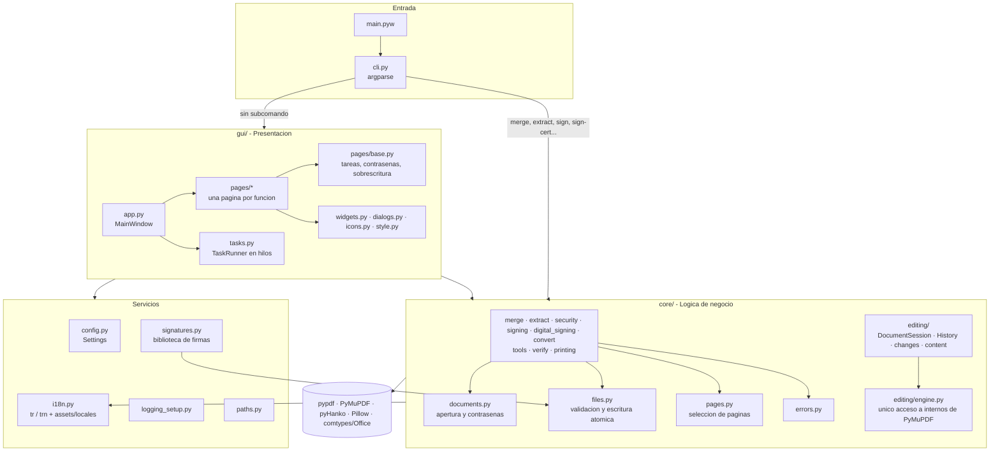
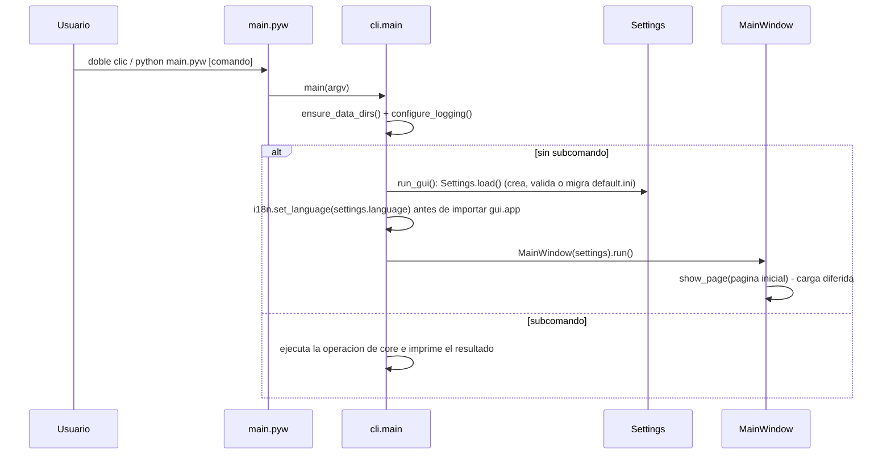
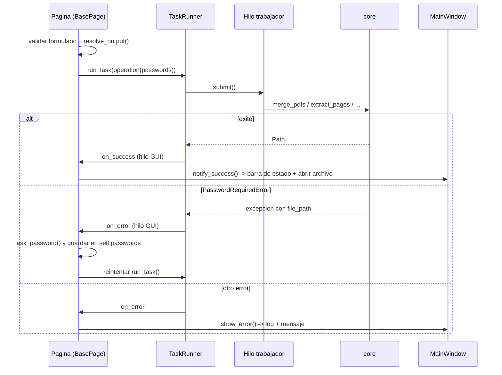
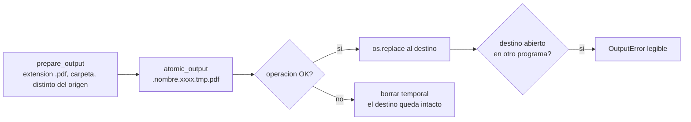
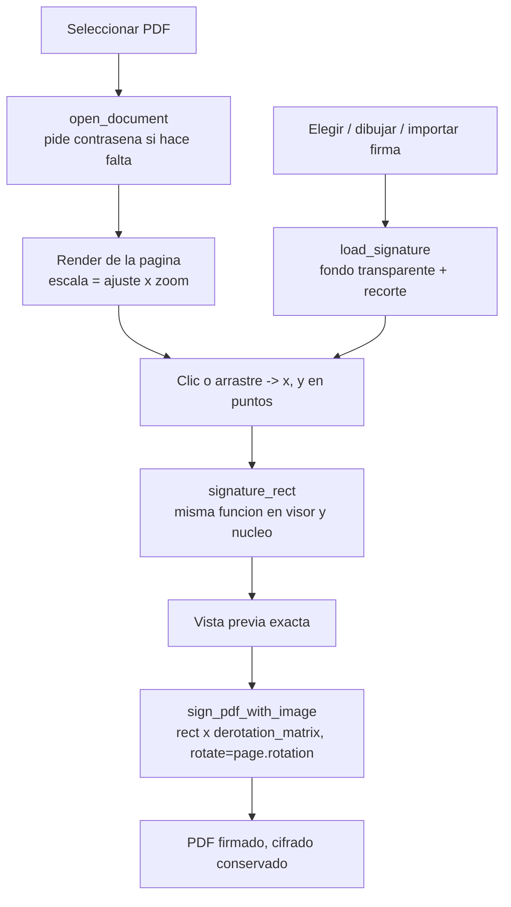
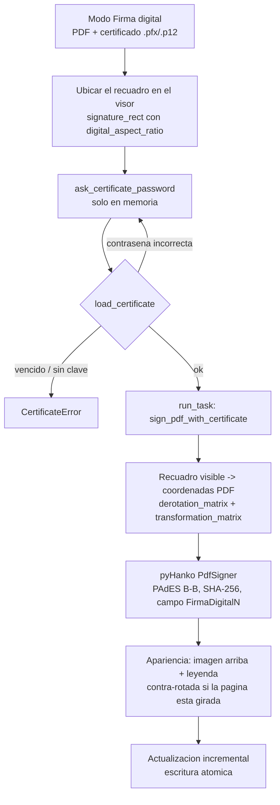
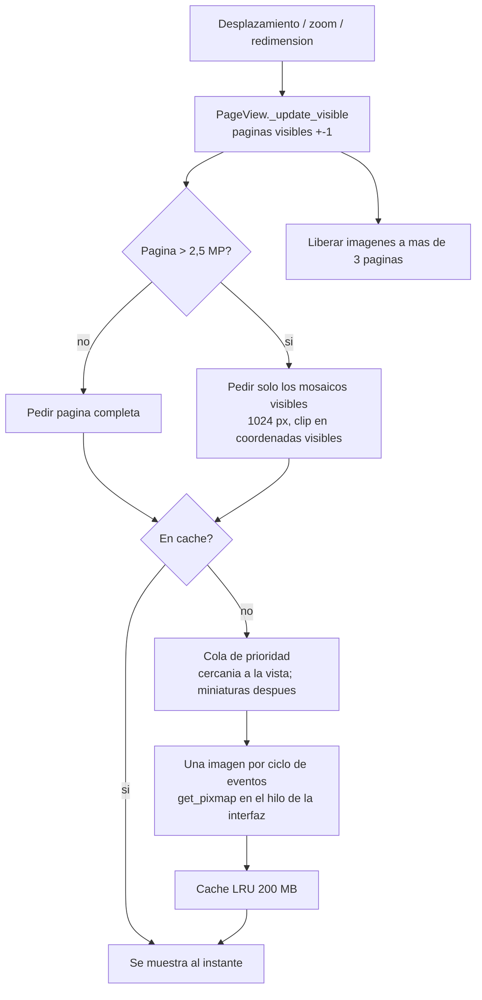
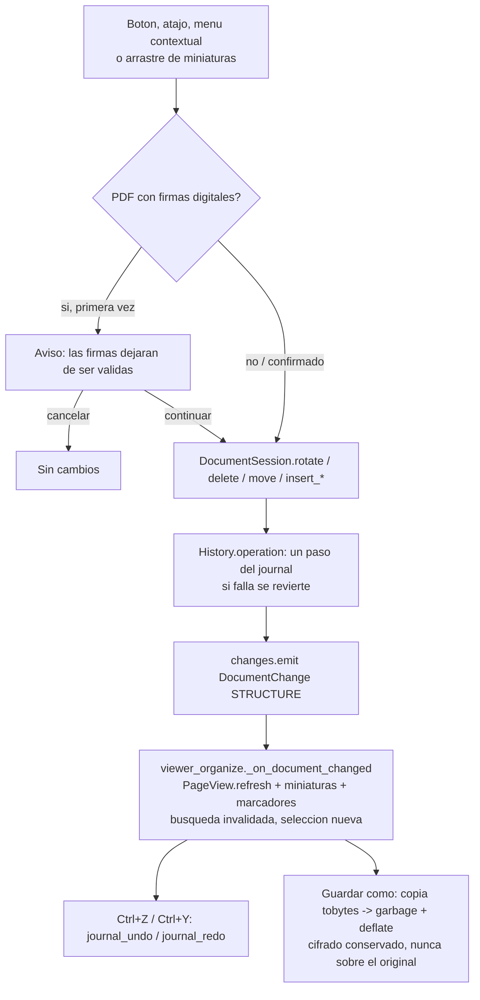
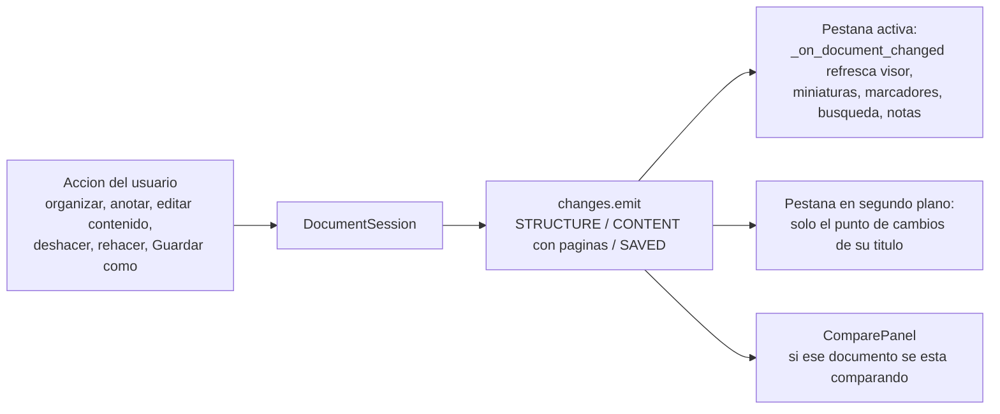
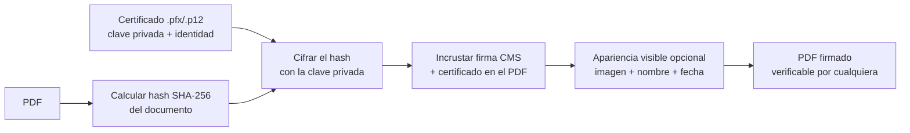

<div align="center">
    <h1>PDF Management</h1>
    <p>Herramienta de escritorio <b>gratuita y 100% local</b> para leer, editar, unir, extraer, convertir, firmar, proteger, comprimir y dividir PDFs.</p>
    
    
    
    
</div>

## Tabla de contenido

1. [Proposito](#proposito)
2. [Funcionalidades](#funcionalidades)
3. [Inicio rapido](#inicio-rapido)
4. [Linea de comandos](#linea-de-comandos)
5. [Arquitectura](#arquitectura)
6. [Estructura del proyecto](#estructura-del-proyecto)
7. [Referencia de modulos](#referencia-de-modulos)
8. [Flujos principales](#flujos-principales)
9. [Datos, configuracion y registros](#datos-configuracion-y-registros)
10. [Decisiones de diseno](#decisiones-de-diseno)
11. [Pruebas](#pruebas)
12. [Como agregar una funcionalidad](#como-agregar-una-funcionalidad)
13. [Firma digital con certificado](#firma-digital-con-certificado)
14. [Hoja de ruta](#hoja-de-ruta)
15. [Creditos](#creditos)

---

## Proposito

Las herramientas para manejar PDFs suelen ser de pago o exigen subir los documentos a internet. PDF Management resuelve las tareas mas comunes de forma **facil y gratuita**, garantizando la privacidad: todo se ejecuta en el equipo del usuario y la aplicacion **no tiene ninguna conexion a internet**.

## Funcionalidades

| Seccion | Que hace | Detalles |
|---|---|---|
| **Visor** | Abre, lee, **anota**, **edita** y **organiza** PDFs | **Nuevo PDF** en blanco o desde plantilla (renglones, cuadricula, carta, acta, factura; A4, Carta u Oficio). Boton **Unir N PDFs** con 2 o mas documentos abiertos (lleva todos a Unir, con sus cambios sin guardar). **Varios documentos en pestanas** como un navegador (mismo ancho, punto de cambios sin guardar, cerrar al pasar el cursor o con clic central, boton **+**; cada una con su pagina, zoom e historial), dos modos de lectura: **visor en toda la ventana** (Ctrl+Mayus+F, con las pestanas) y **pantalla completa** (F11), desplazamiento continuo virtualizado, miniaturas, marcadores, **barra de busqueda flotante** (boton Buscar o Ctrl+F: contador, anterior/siguiente, mayusculas y palabras completas) con lista de resultados, seleccionar y copiar texto, mano, zoom 25-500 % (ajustar ancho / pagina), propiedades, archivos recientes y **Enviar a...** otra seccion. Boton **Ver**: **modo nocturno** (colores invertidos), **dos paginas** lado a lado (ambos se recuerdan), **comparar** con otra pestana u otro PDF en vista dividida (sincronizar paginas) e **imprimir** (Ctrl+P, dialogo de Windows, incluye los cambios sin guardar). Panel lateral con pestanas de iconos: Paginas, Marcadores, Buscar, Notas y **Firmas** (verifica las firmas digitales con pyHanko, sin internet, y permite firmar). Herramientas de edicion con el boton **Editar**. Organizar paginas: rotar, eliminar, reordenar arrastrando miniaturas (seleccion multiple), insertar otro PDF o una pagina en blanco. Anotar: resaltar, subrayar y tachar texto, notas, texto libre (con **tamano de letra** y cuadro que se ajusta al texto), rectangulos, elipses, lineas, flechas y dibujo a mano, con 5 colores y 3 grosores; seleccionar, mover, recolorear, editar y eliminar anotaciones, y panel **Notas** con todas. **Editar el contenido**: reemplazar texto, texto fijo, imagen y **tapar** (redaccion real: borra lo que hay debajo). Barras que se adaptan al ancho (iconos solos, anotacion en dos filas). Deshacer/rehacer ilimitado y **Guardar como** (el original nunca se toca) |
| **Unir** | Combina varios PDFs en uno | Arrastrar archivos o carpetas, reordenar, ordenar A-Z, marcador por archivo, PDFs protegidos; fluida con decenas de archivos; marca de agua del resultado; vista previa navegable de todas las paginas del resultado; Unir y firmar (abre el resultado en Firmar) |
| **Extraer** | Crea un PDF con paginas seleccionadas | Rangos (`1-3, 8, 10-`), `todo`/`impar`/`par`, vista previa de la seleccion, proteger el resultado |
| **Convertir** | Word y Excel a PDF | `.docx .doc .rtf .xlsx .xls` con Microsoft Office |
| **Firmar** | Firma visual o **firma digital con certificado** | Visor con zoom, clic y arrastre, tamano ajustable (asas en las esquinas y control deslizante), paginas rotadas, todas las paginas, dibujar o importar firmas. Modo digital: certificado `.pfx`/`.p12`, PAdES B-B sin internet, apariencia visible o invisible, varias firmas por documento |
| **Proteger** | Cifra o descifra un PDF | AES-256, deteccion automatica del estado, confirmacion de contrasena |
| **Herramientas** | Comprimir, dividir, numerar paginas y marca de agua | **Comprimir** en 3 niveles (baja / media / alta; si el resultado no es mas liviano se conserva una copia del original), **Dividir** por rangos, cada N paginas o por marcadores (archivos en una carpeta), **Numerar paginas** (formato como `Pagina {n} de {total}`, 6 posiciones, numero inicial, paginas a numerar), **Marca de agua** (texto, opacidad, detras o delante del contenido). Los PDFs protegidos conservan su contrasena (AES-256) |
| **Ajustes** | Preferencias | Modo claro/oscuro/sistema, color de acento, escala, **idioma** (Español, English, Русский; al reiniciar), pagina inicial, carpeta de salida. Se guardan solos y quedan como predeterminados al abrir la aplicacion |

Ademas: interfaz en **tres idiomas** (espanol, ingles y ruso), escritura atomica (un error nunca deja archivos corruptos), nunca sobrescribe sin preguntar, barra de estado (listo / en curso con cola / exito / error, con tooltip explicativo y acciones **Abrir**, **Mostrar en carpeta** y **Ver en el visor**), menu lateral contraible a solo iconos con animacion fluida (y el nombre de cada seccion al pasar el cursor), tooltips que no se salen del monitor y se ocultan al cambiar de programa (Alt+Tab), atajos `Ctrl+1..8` y `F1`, y una CLI con las operaciones principales.

**Limitaciones conocidas**: el texto que escriben **Reemplazar texto** y **Texto fijo** usa Helvetica, que solo tiene el alfabeto latino (no se puede escribir cirilico ni otros alfabetos en la pagina); **Numerar paginas** y **Marca de agua** usan Arial de Windows cuando el texto no es latino. La leyenda visible de la firma digital tambien queda en alfabeto latino (en ruso muestra la leyenda en ingles), porque la fuente de la estampa de pyHanko es solo latina.

## Inicio rapido

Requisitos: Windows 10/11 y Python 3.14 (funciona desde 3.12). Microsoft Office solo es necesario para **Convertir**.

```bash
python -m venv venv
```

```bash
venv\Scripts\python.exe -m pip install -r requirements.txt
```

```bash
venv\Scripts\pythonw.exe main.pyw
```

Tambien basta con hacer doble clic en `main.pyw`. Al primer arranque se crean automaticamente las carpetas `config/`, `log/`, `signs/` y `export/` con valores por defecto; no hace falta ningun paso de despliegue.

## Linea de comandos

Sin argumentos se abre la interfaz grafica. Con un subcomando se ejecuta la operacion directamente (use `python.exe`, no `pythonw.exe`, para ver la salida):

```bash
venv\Scripts\python.exe main.pyw --help
```

| Comando | Ejemplo |
|---|---|
| `merge` | `python main.pyw merge a.pdf b.pdf -o unido.pdf --bookmarks` |
| `extract` | `python main.pyw extract informe.pdf -p "1-3,8" -o resumen.pdf` |
| `convert` | `python main.pyw convert carta.docx -o carta.pdf` |
| `sign` | `python main.pyw sign contrato.pdf --image firma.png --page 2 --x 400 --y 700 --width 150` |
| `sign-cert` | `python main.pyw sign-cert contrato.pdf --cert firma.pfx --image firma.png --x 400 --y 700 --reason "Aprobado"` |
| `lock` | `python main.pyw lock contrato.pdf -o protegido.pdf` |
| `unlock` | `python main.pyw unlock protegido.pdf -o libre.pdf` |

Si no se pasa `--password` (o `--cert-password` en `sign-cert`), la contrasena se solicita de forma oculta. En `sign-cert`, sin `--x`/`--y` la firma digital es invisible. Codigos de salida: `0` exito, `1` error de la operacion, `2` argumentos invalidos.

---

## Arquitectura

La aplicacion esta organizada en **capas con dependencias en una sola direccion**: la interfaz conoce al nucleo, pero el nucleo no sabe nada de la interfaz. Esto permite probar toda la logica sin abrir ventanas y reutilizarla desde la CLI.



| Capa | Responsabilidad | Regla |
|---|---|---|
| **Entrada** (`main.pyw`, `cli.py`) | Parsear argumentos, preparar carpetas y logging, elegir GUI o comando | No contiene logica de PDFs |
| **Presentacion** (`gui/`) | Ventanas, validacion de formularios, dialogos, hilos | Solo llama funciones publicas de `core` |
| **Servicios** (`config`, `i18n`, `signatures`, `paths`, `logging_setup`) | Estado persistente, traducciones y recursos de la aplicacion | Sin dependencias de la GUI |
| **Nucleo** (`core/`) | Operaciones sobre PDFs | Funciones puras de entrada/salida de archivos; errores tipados (con mensajes traducidos con `tr`); solo `core/editing/engine.py` toca la API interna de PyMuPDF |

## Estructura del proyecto

```
PDFManagement/
├── main.pyw                    # Punto de entrada (doble clic = GUI)
├── requirements.txt            # Dependencias de ejecucion (versiones fijas)
├── requirements-dev.txt        # + pytest, pytest-cov, ruff y mypy
├── pyproject.toml              # Metadatos y configuracion de pytest, ruff, mypy y coverage
├── .github/workflows/ci.yml    # CI en Windows: ruff, mypy y pytest con cobertura
├── assets/
│   ├── icons/app.ico           # Icono de la aplicacion
│   ├── locales/en.json, ru.json  # Catalogos de traduccion (la clave es el texto en espanol)
│   └── themes/*.json           # Temas de color de CustomTkinter
├── docs/user_guide.md          # Guia de uso (se muestra con F1)
├── src/pdfmanagement/
│   ├── __init__.py             # Nombre y version
│   ├── __main__.py             # python -m pdfmanagement
│   ├── cli.py                  # Subcomandos y arranque
│   ├── paths.py                # Rutas de recursos y datos
│   ├── config.py               # Preferencias (settings.ini)
│   ├── i18n.py                 # Traducciones: tr(), trn(), set_language()
│   ├── logging_setup.py        # Registro rotativo
│   ├── signatures.py           # Biblioteca de firmas (signs/)
│   ├── recent.py               # Archivos recientes del visor (config/recent.json)
│   ├── _vendor/                # Codigo de terceros sin modificar (ver _vendor/README.md)
│   │   └── ctk_scrollable_dropdown/   # Lista desplegable con desplazamiento (MIT)
│   ├── core/
│   │   ├── errors.py           # Jerarquia de excepciones
│   │   ├── files.py            # Validacion de rutas y escritura atomica
│   │   ├── documents.py        # Apertura con contrasena, PdfInfo
│   │   ├── pages.py            # Interprete de selecciones de paginas
│   │   ├── merge.py            # Unir
│   │   ├── extract.py          # Extraer
│   │   ├── security.py         # Proteger / desproteger
│   │   ├── signing.py          # Firma visual (SignaturePlacement, signature_rect)
│   │   ├── digital_signing.py  # Firma digital con certificado (PAdES)
│   │   ├── convert.py          # Office -> PDF
│   │   ├── tools.py            # Comprimir, dividir, numerar paginas, marca de agua
│   │   ├── verify.py           # Verificar firmas digitales existentes (pyHanko, sin internet)
│   │   ├── printing.py         # Imprimir en Windows (ctypes PrintDlgW + GDI, sin pywin32)
│   │   ├── create.py           # Documentos nuevos: en blanco o desde plantilla (dibujadas con PyMuPDF)
│   │   ├── finish.py           # Terminaciones: marca de agua y firma de un PDF ya generado (Unir) y su vista previa
│   │   └── editing/            # Base del visor/editor (sin GUI)
│   │       ├── engine.py       # Unico modulo que toca internos de PyMuPDF (7 comportamientos rodeados)
│   │       ├── session.py      # DocumentSession: documento abierto, ediciones, Guardar como
│   │       ├── changes.py      # ChangeNotifier y DocumentChange: avisos de cambios
│   │       ├── history.py      # History: deshacer/rehacer con el journal de PyMuPDF
│   │       ├── pages.py        # Rotar, eliminar, mover e insertar paginas (compatibles con el journal)
│   │       ├── text.py         # Texto en coordenadas visibles sin modificar la pagina
│   │       ├── annotations.py  # Crear, mover, recolorear, editar y eliminar anotaciones
│   │       ├── content.py      # Reemplazar texto, texto e imagen fijos, tapar (redaccion)
│   │       └── search.py       # iter_search: busqueda incremental por paginas
│   └── gui/
│       ├── app.py              # MainWindow: barra lateral, paginas, estado
│       ├── tasks.py            # TaskRunner (hilos + sondeo seguro)
│       ├── status_bar.py       # Barra de estado (progreso, resultado, errores)
│       ├── appearance.py       # Cambio de tema priorizado (visible primero)
│       ├── dropdown.py         # Desplegables con desplazamiento (envoltorio de _vendor)
│       ├── popup_menu.py       # Menus emergentes con el estilo de los desplegables (Ver, contextuales, tamano)
│       ├── ctk_fixes.py        # Ajuste de rendimiento de CustomTkinter (barras sin repintar toda la ventana)
│       ├── new_document.py     # Dialogo Nuevo PDF: plantillas con vista previa, tamano, orientacion
│       ├── finish_controls.py  # Controles compartidos: marca de agua y vista previa (Herramientas, Unir)
│       ├── style.py            # Tipografia, espaciado y colores
│       ├── icons.py            # Iconos desde la fuente de Windows
│       ├── widgets.py          # Card, FileField, PasswordField, ToolTip...
│       ├── dialogs.py          # Contrasena, ayuda, lienzo de firma
│       ├── system.py           # Abrir archivos / mostrar en carpeta
│       ├── viewer/             # Visor reutilizable (Visor y Firmar)
│       │   ├── render.py       # RenderScheduler: cola de prioridad + cache LRU + mosaicos + colores invertidos
│       │   ├── page_view.py    # PageView: lienzo virtualizado, zoom, dos paginas, coordenadas, herramientas
│       │   ├── toolbar.py      # ViewerToolbar: navegacion y zoom
│       │   ├── thumbnails.py   # ThumbnailStrip: miniaturas perezosas
│       │   ├── tools.py        # HandTool, TextSelectTool
│       │   ├── annotation_tools.py  # Gestos de anotacion: marcar texto, arrastrar formas, trazo, nota, seleccionar/mover
│       │   ├── element_tool.py # Seleccionar: anotaciones, lineas de texto e imagenes de la pagina
│       │   ├── inline_editor.py  # Campo de texto sobre la pagina (en lugar de cuadros de dialogo)
│       │   ├── wheel.py        # Rueda y panel tactil (<TouchpadScroll> de Tk 9) en pasos enteros
│       │   ├── find_bar.py     # FindBar: barra de busqueda flotante (como en los navegadores)
│       │   ├── tab_strip.py    # TabStrip: pestanas de documentos con aspecto de navegador
│       │   ├── icon_tabs.py    # IconTabs: pestanas con icono del panel lateral
│       │   ├── compare.py      # ComparePanel: segundo visor para comparar (vista dividida)
│       │   ├── signatures_panel.py  # SignaturesPanel: estado de las firmas digitales
│       │   └── panels.py       # OutlinePanel (marcadores), SearchPanel (busqueda), AnnotationsPanel (notas)
│       └── pages/
│           ├── registry.py     # Lista ordenada de paginas
│           ├── base.py         # BasePage
│           ├── viewer.py       # ViewerPage: construccion de la seccion, atajos, barras adaptables
│           ├── viewer_tabs.py  # Mixin: pestanas de documentos (DocumentTab)
│           ├── viewer_files.py # Mixin: abrir, Guardar como, propiedades, Enviar a, recientes
│           ├── viewer_organize.py  # Mixin: organizar paginas, deshacer/rehacer, avisos de cambios, modo edicion
│           ├── viewer_modes.py # Mixin: toda la ventana y pantalla completa
│           ├── viewer_display.py   # Mixin: modo nocturno, dos paginas, comparar, imprimir, firmas
│           ├── viewer_annotations.py  # ViewerAnnotations: barra, colores, seleccion, edicion de contenido y panel Notas
│           ├── tools.py        # ToolsPage: seccion Herramientas
│           └── merge.py · extract.py · convert.py · sign.py · security.py · settings.py
└── tests/                      # Pruebas automatizadas (pytest)
```

Carpetas creadas en tiempo de ejecucion (ignoradas por git): `config/`, `log/`, `signs/`, `export/`.

## Referencia de modulos

### `core` - operaciones

Todas las funciones validan sus entradas, escriben el resultado de forma atomica y **devuelven la ruta generada**. Las paginas para el usuario siempre empiezan en **1**.

| Funcion | Descripcion |
|---|---|
| `merge_pdfs(pdf_files, output_file, *, passwords=None, add_bookmarks=False)` | Une en el orden recibido; ignora duplicados; `passwords` es un `dict[Path, str]` para PDFs protegidos |
| `extract_pages(input_file, output_file, selection, *, password=None, output_password=None)` | Copia las paginas de `selection`; puede cifrar el resultado |
| `lock_pdf(input_file, output_file, password, *, owner_password=None)` | Cifra con AES-256 conservando marcadores, formularios y metadatos |
| `unlock_pdf(input_file, output_file, password)` | Copia sin cifrado; exige la contrasena correcta |
| `sign_pdf_with_image(input_file, output_file, signature_image, placement, *, password=None)` | Estampa la firma segun un `SignaturePlacement`; conserva el cifrado del original |
| `sign_pdf_with_certificate(input_file, output_file, pfx_path, pfx_password, *, placement=None, signature_image=None, reason=None, location=None, password=None)` | Firma digital PAdES B-B (SHA-256) con un `.pfx`/`.p12` mediante actualizacion incremental; `placement=None` crea una firma invisible |
| `load_certificate(pfx_file, pfx_password)` | Verifica contrasena, clave privada y vigencia; devuelve `CertificateInfo(subject, issuer, valid_from, valid_until, self_signed)` |
| `digital_aspect_ratio(image_aspect)` | Proporcion del recuadro de la firma digital: imagen (opcional) + leyenda de alto `CAPTION_RATIO` x ancho |
| `convert_to_pdf(input_file, output_file)` | Word/Excel a PDF via COM |
| `parse_page_selection(selection, total_pages)` | Texto a indices base cero (`"3,1-2"` -> `[2, 0, 1]`) |
| `get_pdf_info(pdf_file)` | `PdfInfo(path, page_count, size_bytes, encrypted)` sin pedir contrasena |
| `open_document(path, password)` | Abre con PyMuPDF manejando contrasenas (usado por el visor) |
| `load_signature(image)` | Imagen RGBA lista para estampar: fondo blanco transparente y margenes recortados |
| `signature_rect(page_rect, placement, aspect_ratio)` | Rectangulo visible de la firma, ajustado a la pagina; **compartido por visor y estampa** |
| `unique_path(path)` | `nombre (2).pdf` si `path` ya existe |
| `tools.compress_pdf(input_file, output_file, level="media", *, password=None)` | Niveles `baja` (limpieza y compresion de flujos), `media` y `alta` (ademas reduce imagenes y subconjunta fuentes); si no reduce, copia el original. Devuelve `CompressionResult(path, size_before, size_after, saved_ratio)` |
| `tools.split_pdf(input_file, output_dir, mode, value="", *, password=None)` | `mode`: `rangos` (`"1-3; 4-6; 7-"`), `cada` (paginas por archivo) o `marcadores` (uno por marcador de primer nivel); devuelve la lista de archivos |
| `tools.add_page_numbers(input_file, output_file, *, template=None, position="abajo-centro", start=1, fontsize=10, color=..., pages=None, password=None)` | `template` con `{n}` y `{total}` (por defecto `tr("Página {n} de {total}")`); 6 posiciones (`POSITIONS`) en la pagina tal como se ve |
| `tools.add_watermark(input_file, output_file, text, *, fontsize=60, opacity=0.15, angle=45, color=..., pages=None, behind=False, password=None)` | Texto centrado y girado; se reduce si no cabe en la diagonal; `behind=True` lo pone detras del contenido |
| `verify.verify_signatures(pdf_file, password=None)` | Lista de `SignatureReport(field, signer, signed_at, intact, valid, trusted, modified_after, error)` con `state` (`valida`, `identidad_no_verificada`, `modificada`, `invalida`) y `summary` legible; `ValidationContext(allow_fetching=False)`: sin OCSP/CRL |
| `printing.print_document(document, title, owner=0, progress=None)` | Dialogo nativo `PrintDlgW` y GDI via `PIL.ImageWin` (hasta 300 ppp, ajustado al area imprimible y girado si conviene); devuelve las paginas impresas o `None` si se cancela |

Las herramientas (`tools`), al igual que el resto, nunca modifican el original y conservan la contrasena (AES-256) del documento protegido. Helvetica escribe los textos; si no puede (p. ej. cirilico), `TextFont` usa `C:\Windows\Fonts\arial.ttf`.

`SignaturePlacement(x, y, width=150, page_number=None, all_pages=False)`: coordenadas en puntos sobre la pagina **tal como se ve** (origen arriba a la izquierda); `page_number=None` significa la ultima pagina.

### `core.editing` - base del visor y del editor

| Elemento | Descripcion |
|---|---|
| `DocumentSession.open(path, password=None)` | Abre el PDF (pide contrasena con los errores tipados de `open_document`); `page_count`, `page_rect(i)`, `page_sizes()`, `words(i)` (cache por pagina), `table_of_contents()`, `properties()`, `has_signatures()`, `modified`, `close()` |
| `DocumentSession.save_as(output, keep_encryption=True)` | **Siempre Guardar como**: rechaza escribir sobre el original, guarda una copia compacta (`garbage=3`, `deflate`) de forma atomica y conserva el cifrado AES-256 con la misma contrasena si se pide; el historial de deshacer sigue disponible |
| `DocumentSession.rotate(pages, angle)`, `delete(pages)`, `move(pages, target)`, `insert_pdf(path, at, password=None)`, `insert_blank(at, size=None)` | Organizar paginas (indices desde 0). Cada llamada es **un paso deshacible** con etiqueta legible ("Mover 3 paginas"); `delete` nunca deja el documento vacio; `move` devuelve los nuevos indices y no registra nada si el orden no cambia; `insert_pdf` pide contrasena con los errores tipados y copia contenido, rotacion y anotaciones |
| `DocumentSession.undo()`, `redo()` | Deshacer/rehacer y descartar la cache de texto |
| `DocumentSession.add_markup(page, kind, rects, style)`, `add_note()`, `add_free_text()`, `add_shape()`, `add_line(..., arrow)`, `add_ink()` | Anotaciones en coordenadas de la pagina **tal como se ve** (tambien giradas); cada una es un paso deshacible ("Resaltar texto (pagina 3)"). `AnnotationStyle(color, width, opacity)` |
| `DocumentSession.annotations(page=None)`, `move_annotation()`, `delete_annotation()`, `set_annotation_color()`, `set_annotation_text()` | Listar (`AnnotationInfo`: tipo, etiqueta traducida, rectangulo visible, contenido, color, `movable`, `has_text`) y editar anotaciones existentes; mover devuelve el xref nuevo si hubo que recrearla |
| `DocumentSession.replace_text(page, rects, new_text)`, `add_fixed_text(page, point, text, fontsize, color)`, `add_image(page, rect, image_file)`, `redact(page, rect)` | Editar el contenido (`content.py`): cada una es un paso deshacible. `replace_text` borra solo el texto (no fondos ni imagenes) y escribe el nuevo con el tamano, color y direccion del original en Helvetica; `add_image` conserva la proporcion y queda derecha en paginas giradas; `redact` aplica una redaccion real (borra texto, imagenes y dibujos de la zona). Textos que Helvetica no puede escribir se rechazan (`helvetica_can_write`) |
| `DocumentSession.changes` | `ChangeNotifier`: emite un `DocumentChange(kind, label, pages)` tras cada edicion, deshacer, rehacer o guardado. `kind`: `STRUCTURE` (paginas giradas, movidas, insertadas, eliminadas; deshacer/rehacer), `CONTENT` (solo cambio lo dibujado en `pages`) o `SAVED`. `subscribe(listener)` devuelve la funcion para darse de baja |
| `engine` | Puente con PyMuPDF: `visible_textpage`, `graft_pages`, `add_blank_page`, `reset_page_refs`, `journal_step`, `prepare_font_cache`, `ensure_text_font`, `was_encrypted`. Su docstring enumera los 7 comportamientos de PyMuPDF/MuPDF que rodea y `tests/test_engine.py` verifica cada uno; `check_version()` registra un aviso si PyMuPDF no es 1.28.x |
| `History(document, on_change)` | Deshacer/rehacer sobre el *journal* de PyMuPDF: `with history.operation("Rotar"):` agrupa cambios y, si algo falla, revierte la operacion; `undo()`, `redo()`, `undo_label`, `redo_label`, `undo_depth`, `modified` (vuelve a "sin cambios" al deshacer hasta lo guardado), `mark_saved()` |
| `pages.insert_document()`, `pages.insert_blank_page()` | Insertan con las primitivas de MuPDF (`pdf_graft_mapped_page`, `pdf_add_page`), las unicas que funcionan dentro de una operacion del journal |
| `text.page_words(page, sort=False)`, `text.page_search(page, query)` | Texto y busqueda en coordenadas de la pagina **tal como se ve**, sin tocar el documento (ver Decisiones de diseno) |
| `iter_search(document, query, options, start_page=0)` | Generador `(pagina, [SearchHit])` que recorre el documento desde `start_page` y da la vuelta; `SearchOptions(match_case, whole_words)`; cada `SearchHit` trae rectangulos y contexto |
| `recent.load_recent()`, `add_recent(path)`, `clear_recent()` | Ultimos 10 archivos abiertos en el visor |

### `core.errors` - excepciones

```
PdfManagementError            # base: su mensaje se muestra al usuario
├── InvalidInputError         # rutas, extensiones, selecciones, validaciones
├── OutputError               # no se pudo escribir (p. ej. archivo abierto en otro programa)
├── ConversionError           # Office no disponible o fallo la exportacion
├── PasswordRequiredError     # .file_path indica que PDF necesita contrasena
│   └── WrongPasswordError    # la contrasena indicada no es valida
└── DigitalSignatureError     # pyHanko no pudo firmar el documento
    └── CertificateError      # certificado danado, sin clave privada, vencido o aun no vigente
        └── WrongCertificatePasswordError  # .certificate_path: contrasena del .pfx incorrecta
```

Cualquier otra excepcion se considera un **error inesperado**: se registra con traza completa en `log/error.log` y se informa al usuario.

### Servicios

| Modulo | Elementos clave |
|---|---|
| `config.py` | `Settings` (dataclass): `load()` crea, valida y migra; `save()` escribe `config/settings.ini`; `output_path` |
| `i18n.py` | `tr(text, **values)` y `trn(singular, plural, count, **values)`: el texto en espanol (con tildes) es la clave; `assets/locales/en.json` y `ru.json` lo asocian a su traduccion (plurales como lista: 2 formas en ingles, 3 en ruso, ver `plural_form`). Sin traduccion se muestra el espanol. `set_language(code)` se llama en `run_gui` **antes de importar la interfaz** (sus textos se traducen al cargarse); `LANGUAGES`, `language()`. La guia se busca como `docs/user_guide.<codigo>.md` y, si no existe, se usa la de espanol |
| `signatures.py` | `list_signatures()`, `import_signature()`, `signature_path_for()`, `delete_signature()` |
| `paths.py` | Rutas de recursos (`ASSETS_DIR`, `THEMES_DIR`...) y datos (`CONFIG_DIR`, `LOG_DIR`, `SIGNATURES_DIR`, `EXPORT_DIR`); soporte para PyInstaller |
| `logging_setup.py` | `configure_logging(debug=False)`: `log/app.log` y `log/error.log` rotativos; `set_debug()` activa el modo detallado en caliente; captura excepciones no controladas (tambien de hilos) |
| `gui/events.py` | `log_event()` / `debug_event()`: eventos de la interfaz con formato `[Seccion] mensaje  \| clave=valor`, una linea por evento y contrasenas ocultas; `area_of()`, `describe_files()`, `timed()` |
| `cli.py` | `main(argv) -> int`, `build_parser()` |

### `gui` - presentacion

| Elemento | Responsabilidad |
|---|---|
| `MainWindow` (`app.py`) | Crea la ventana (CustomTkinter + tkdnd), barra lateral contraible (`toggle_sidebar()`, se recuerda en `sidebar_collapsed`), precarga y apilado de paginas, barra de estado, `notify_success()`, `show_error()`, apariencia, reinicio, recordar tamano |
| `BasePage` (`pages/base.py`) | Encabezado (`show_header = False` para secciones que necesitan todo el espacio, como el Visor), `run_task()` (hilo + reintento con contrasena), `resolve_output()` (politica de sobrescritura), `default_output()`, `guard()` |
| `TaskRunner` (`tasks.py`) | Pool de 2 hilos; el hilo de la GUI sondea cada 80 ms y ejecuta los callbacks |
| `StatusBar` (`status_bar.py`) | Estados `idle` / `busy` / `success` / `error` con indicador de color, tareas en cola, hora de finalizacion, tooltip dinamico y acciones sobre el ultimo archivo |
| `AppearanceScheduler` (`appearance.py`) | Al cambiar de tema redibuja primero lo que se ve, con el pintado congelado, y difiere por lotes las secciones ocultas y las filas fuera de vista; `flush_page()` actualiza una seccion pendiente antes de mostrarla |
| `dropdown_menu()`, `set_dropdown_values()` (`dropdown.py`) | `CTkOptionMenu` con lista desplazable: muestra como mucho 5 opciones (`MAX_VISIBLE`) y las demas con una barra de desplazamiento con colores visibles (parametros `height`, `scrollbar_button_color` y `scrollbar_button_hover_color` del componente de `_vendor`), mide lo mismo que el control a cualquier escala, resalta la opcion actual, se abre hacia arriba si no cabe y se cierra con clic fuera, Escape o al mover la ventana. Se usa en todos los desplegables (recientes, zoom, tamano de letra, firmas guardadas y Ajustes) |
| `PopupMenu` (`popup_menu.py`) | Menu emergente con el mismo aspecto que las listas desplegables; admite el subconjunto de `tk.Menu` que usa la app (`add_command`, `add_checkbutton`, `add_separator`, `add_cascade`, `tk_popup`). Se cierra al elegir, con Esc, al hacer clic fuera, al mover la ventana o al cambiar de aplicacion. Lo usan el menu **Ver**, los menus contextuales del Visor y el selector de **Fondo** |
| `NewDocumentDialog`, `ask_new_document()` (`new_document.py`) | Dialogo **Nuevo PDF**: tarjetas de plantilla con vista previa real, tamano, orientacion y paginas; devuelve un `core.create.NewDocument` |
| `InlineEditor` (`viewer/inline_editor.py`) | Campo de texto dibujado en el lienzo del visor, con la letra al tamano real de la pagina: notas, cuadros de texto, texto fijo, reemplazar texto y editar anotaciones se escriben en su lugar. Enter aplica, Mayus+Enter agrega una linea, Esc cancela, clic fuera aplica; se reubica al cambiar el zoom |
| `ElementTool`, `Selection` (`viewer/element_tool.py`) | Herramienta **Seleccionar**: marca al pasar el cursor y selecciona anotaciones (primero), lineas de texto o imagenes (`DocumentSession.elements`); arrastrar mueve anotaciones, doble clic edita, Supr elimina (`erase_text`, `remove_image`) |
| `WatermarkControls`, `PreviewPane` (`finish_controls.py`) | Opciones de marca de agua y vista previa de una pagina; las mismas en Herramientas y Unir |
| `set_label_image()` (`widgets.py`) | Cambia o quita la imagen de un `CTkLabel` sin dejarla pegada ni referenciar imagenes ya liberadas (`image "pyimageN" does not exist`) |
| `FileField`, `PasswordField`, `Card`, `ToolTip`, `enable_file_drop` (`widgets.py`) | Componentes reutilizables y consistentes |
| `ask_password`, `ask_certificate_password`, `HelpWindow`, `SignaturePad` (`dialogs.py`) | Ventanas modales y secundarias. `HelpWindow` muestra la guia con indice lateral, bloques de codigo con boton Copiar y puede abrirse en una seccion (`open_help(section)`) |
| `ViewerPage` (`pages/viewer.py`) | Seccion Visor (la primera), repartida en mixins: `viewer.py` (construccion, atajos, `fit_bars`: con poco ancho Buscar/Editar quedan solo con icono y la barra de anotacion pasa a dos filas), `viewer_tabs.py` (pestanas `DocumentTab`: sesion, ultimo Guardar como, pagina, zoom, desplazamiento y seleccion de cada una; hasta 12; abrir un archivo ya abierto muestra su pestana), `viewer_files.py` (Abrir, Recientes, Propiedades, Guardar como, Enviar a...), `viewer_organize.py` (organizar paginas, deshacer/rehacer, modo edicion con **Editar**, menu contextual, avisos de cambios sin guardar y de firmas digitales; `_on_document_changed` es el **unico lugar que refresca la vista** cuando la sesion avisa un cambio), `viewer_modes.py` (`set_view_mode`: toda la ventana o pantalla completa) y `viewer_display.py` (boton **Ver**: modo nocturno y dos paginas que se guardan en `[Viewer]`, comparar, imprimir con Ctrl+P, panel Firmas). Panel lateral plegable (Paginas con barra de organizacion / Marcadores / Buscar / Notas / Firmas); atajos activos solo en esta seccion |
| `PageView` (`viewer/page_view.py`) | Lienzo de paginas continuo o de pagina unica, con vista de dos paginas (`set_spread`: pares lado a lado) y modo nocturno (`set_inverted`): solo dibuja las paginas visibles (+-1) y libera las lejanas, zoom por pasos o ajustado (`FIT_WIDTH`, `FIT_PAGE`) anclado al cursor, mosaicos con zoom alto, conversion `canvas_to_page` / `page_to_canvas`, resaltados de busqueda y herramientas enchufables (`Tool`) |
| `RenderScheduler` (`viewer/render.py`) | Dibuja una imagen por ciclo de eventos en el hilo de la interfaz, por prioridad, con cache LRU de 200 MB; los pedidos obsoletos se descartan (`cancel_where` por solicitante); en modo nocturno genera las imagenes invertidas (la cache se vacia al cambiar) |
| `ComparePanel` (`viewer/compare.py`) | Segundo `PageView` de solo lectura a la derecha del principal, con "Sincronizar paginas" y cerrar; se suscribe a `changes` del documento comparado para actualizarse |
| `SignaturesPanel` (`viewer/signatures_panel.py`) | Tarjetas por firma (Valida / Identidad no verificada / Modificado despues de firmar / No valida) con firmante, fecha y campo; botones Verificar y Firmar... (envia a Firmar). La verificacion corre en el `TaskRunner` |
| `TabStrip` (`viewer/tab_strip.py`), `IconTabs` (`viewer/icon_tabs.py`) | Pestanas de documentos de igual ancho (se encogen), punto de cambios sin guardar, cerrar al pasar el cursor o con clic central, boton **+**; pestanas del panel lateral como iconos con tooltip y el nombre de la activa debajo (ocupan lo mismo en cualquier idioma) |
| `ToolsPage` (`pages/tools.py`) | Seccion Herramientas: un documento de origen y un selector Comprimir / Dividir / Numerar paginas / Marca de agua; Dividir pide una carpeta en vez de un archivo de salida |
| `FindBar` (`viewer/find_bar.py`) | Barra de busqueda flotante sobre el visor: comparte texto y motor con `SearchPanel` (que muestra la lista), Enter / Mayus+Enter, contador "3 de 25", mayusculas, palabras completas y Esc para cerrar |
| `ViewerAnnotations` (`pages/viewer_annotations.py`) | Herramientas de anotacion (resaltar/subrayar/tachar y reemplazar texto se aplican al instante si ya hay texto seleccionado), herramientas de contenido (Reemplazar texto, Texto fijo, Imagen, Tapar), 5 colores, 3 grosores, tamano de letra (para textos nuevos o el seleccionado), seleccion con contorno discontinuo, mover arrastrando, doble clic para editar texto, Supr para eliminar, menu contextual y panel Notas; `fit_width` pasa el grupo de estilo a una segunda fila si no cabe |
| `ToolTip`, `monitor_work_area` (`widgets.py`) | Tooltips siempre dentro del area util del monitor del widget; se ocultan cuando la ventana pierde el foco (Alt+Tab) |
| `SelectTool`, `MarkupTool`, `DragTool`, `InkTool`, `NoteTool` (`viewer/annotation_tools.py`) | Gestos con vista previa en el lienzo; sobre un resaltado, arrastrar sigue seleccionando el texto de debajo |
| `ViewerToolbar`, `ThumbnailStrip`, `HandTool`, `TextSelectTool`, `OutlinePanel`, `SearchPanel` (`viewer/`) | Navegacion y zoom; miniaturas perezosas con seleccion multiple (clic, Ctrl, Mayus), arrastre para reordenar con linea de destino y desplazamiento automatico; mano; seleccion de texto por palabras entre paginas; marcadores; busqueda incremental con presupuesto de 15 ms por ciclo |
| `icon(name, size, color)` (`icons.py`) | Iconos vectoriales de Segoe Fluent Icons en dos colores (claro/oscuro) |

## Flujos principales

### Arranque



### Ejecucion de una operacion desde la GUI (con contrasena)



### Escritura atomica de resultados



### Firma visual



### Firma digital



### Visor: dibujo de paginas



### Visor: editar paginas



Las operaciones tardan 25-70 ms en un PDF de 60 paginas (incluida la actualizacion del visor); guardar como, ~70 ms.

### Visor: avisos de cambios



Cada pestana se suscribe a su sesion al abrirse y se da de baja al cerrarse; con `CONTENT` solo se redibujan las paginas indicadas y sus miniaturas. Las acciones ya no recuerdan a mano todo lo que hay que actualizar.

La busqueda sigue el mismo principio: `SearchPanel` avanza `iter_search` en porciones de 15 ms y publica los resaltados como maximo cada 150 ms, asi la ventana responde mientras recorre documentos largos.

### Politica de sobrescritura (`BasePage.resolve_output`)

| Origen de la ruta de salida | Si el archivo ya existe |
|---|---|
| Sugerida automaticamente | Se elige un nombre libre: `nombre (2).pdf` |
| Elegida en "Guardar como" | Se respeta (el dialogo del sistema ya pregunto) |
| Escrita a mano | Se pide confirmacion |

## Datos, configuracion y registros

| Ruta | Contenido |
|---|---|
| `config/settings.ini` | Preferencias. Secciones `[Window]`, `[Appearance]`, `[General]`, `[Viewer]`. Se regenera si falta; los valores invalidos se corrigen al cargar. Ajustes las guarda al instante y son los valores con que arranca la aplicacion |
| `config/default.ini` | Formato anterior (v3). Se migra automaticamente a `settings.ini` |
| `log/app.log` | Actividad: acciones del usuario, operaciones y resultados (INFO); detalle fino en modo detallado (DEBUG). Rotacion 1 MB x 3 |
| `log/error.log` | Errores con traza completa |
| `signs/` | Firmas guardadas (PNG/JPG) |
| `export/` | Carpeta de salida por defecto (configurable en Ajustes) |

Ejemplo de `settings.ini`:

```ini
[Window]
window_width = 1360
window_height = 860
window_maximized = no
sidebar_collapsed = no

[Appearance]
appearance_mode = System
color_theme = AzulOscuro
ui_scaling = 1.0

[General]
initial_page = Visor
open_after_save = yes
output_dir =
debug_logging = no
language = es

[Viewer]
viewer_night_mode = no
viewer_two_pages = no
```

`language` admite `es`, `en` o `ru` (se aplica al reiniciar); `viewer_night_mode` y `viewer_two_pages` guardan las opciones del boton **Ver** del Visor.

Para mover todos los datos del usuario (por ejemplo a `%APPDATA%` al distribuir la app) basta con cambiar `DATA_DIR` en `paths.py`.

### Registro de eventos (depuracion)

Cada sesion queda registrada en `log/app.log` con una linea por evento:

```
[2026-10-17 10:32:24.075] INFO    MainThread    gui.events: [Unir] Unir PDFs solicitado: a.pdf, b.pdf  | archivos=2, marcadores=True, salida=...\PDF_unido.pdf
[2026-10-17 10:32:24.080] INFO    MainThread    gui.tasks: Tarea #2 iniciada: Uniendo PDFs (en curso: 1)
[2026-10-17 10:32:24.143] INFO    pdf-task_0    core.merge: PDF unido (2 archivos): ...\PDF_unido.pdf
[2026-10-17 10:32:24.220] INFO    MainThread    gui.tasks: Tarea #2 'Uniendo PDFs' terminada en 0.14 s -> PDF_unido.pdf
[2026-10-17 10:32:36.750] DEBUG   MainThread    gui.events: [Firmar] Visor: zoom 125%
```

Columnas: fecha y hora con milisegundos, nivel, hilo (`MainThread` es la interfaz; `pdf-task_N` las operaciones en segundo plano), modulo y mensaje.

| Nivel | Que se registra |
|---|---|
| **INFO** (siempre) | Inicio y fin de sesion (version, sistema, pantalla, escala, tema), navegacion entre secciones y su origen (barra lateral, atajo), tipo de firma o accion elegida, archivos elegidos (dialogo o arrastre), agregados, movidos, quitados u ordenados, firmas seleccionadas, dibujadas, importadas o borradas, cada cambio de ajustes (`antes -> despues`), operaciones solicitadas con sus parametros, tareas numeradas con duracion y resultado, avisos y errores mostrados, decisiones de sobrescritura y solicitudes de contrasena |
| **DEBUG** (modo detallado) | Paginas y zoom del visor, posicion y tamano de la firma (valor final de cada arrastre), apertura y eleccion en desplegables, construccion de paginas y tiempos, cambio de tema, tamano final de la ventana, dialogos cancelados |

Activar el modo detallado (se aplica al instante):

- **Ajustes > Datos locales > Registro detallado (para depurar)**; el boton **Ver registro** abre `app.log`.
- `python main.pyw --debug` (ademas lo muestra en la consola).
- Variable de entorno `PDFMANAGEMENT_DEBUG=1`.

Las **contrasenas nunca se registran**: los valores cuya clave parece una contrasena se escriben como `***`, y los dialogos solo dejan constancia de que se pidio, se ingreso o se cancelo.

## Decisiones de diseno

- **Nucleo sin GUI.** Facilita las pruebas, la CLI y futuras interfaces.
- **pypdf + PyMuPDF.** pypdf para operaciones estructurales y cifrado AES-256 (conserva marcadores y formularios); PyMuPDF para renderizar y estampar imagenes con precision.
- **pyHanko para la firma digital.** Python puro, mantenido y con soporte PAdES; firma con actualizaciones incrementales, asi varias personas pueden firmar el mismo PDF. Todo es local: no consulta TSA, OCSP ni CRL.
- **Coordenadas "como se ve".** El usuario trabaja sobre la pagina visible; el nucleo convierte con `derotation_matrix`, asi las paginas rotadas funcionan sin casos especiales.
- **Errores tipados.** La GUI decide que hacer segun el tipo (`PasswordRequiredError` -> pedir clave) en lugar de comparar textos.
- **Hilos sin tocar widgets.** Tkinter no es seguro entre hilos; los trabajadores solo calculan y el hilo principal sondea los resultados.
- **Preferencias autocorregibles.** Un `settings.ini` danado o de una version anterior nunca impide arrancar.
- **Iconos desde la fuente del sistema.** Sin PNGs que mantener, nitidos a cualquier escala y adaptados al tema.
- **Arranque rapido y precarga.** Solo se construye la pagina inicial; las demas se precargan una a una en los ciclos libres posteriores (`_prebuild_pages`), asi el primer cambio de seccion ya es inmediato.
- **Paginas apiladas.** Las paginas comparten la misma celda y mostrar una es traerla al frente (~30-70 ms frente a ~100-190 ms de volver a mapearla). Como mantener paginas ocultas montadas encarece el redimensionado (x4), al cambiar el tamano de la ventana se desmontan y se reapilan de a una cuando queda quieta.
- **Lista de Unir incremental.** Filas persistentes que solo se recolocan al mover, quitar u ordenar (mover: de ~5 s a ~15 ms con 40 archivos); filas nuevas construidas por lotes entre eventos (la ventana responde en ~20 ms al agregar 40 archivos); metadatos leidos en un hilo; arrastrar y soltar registrado en el contenedor y no en cada widget.
- **Cambio de tema priorizado.** CustomTkinter redibuja todos los widgets al cambiar de tema (~1,2 s con todas las secciones). `AppearanceScheduler` redibuja primero solo lo visible (~200 ms) con el pintado de la ventana congelado (`WM_SETREDRAW`), asi el cambio aparece completo en un solo cuadro; el resto se actualiza en segundo plano. Tambien aplica al modo "Sistema".
- **Codigo de terceros aislado.** Los componentes externos viven sin modificar en `_vendor/` (convencion de `pip`/`setuptools`); los ajustes propios van en un envoltorio (`gui/dropdown.py`), asi actualizar un componente es reemplazar sus archivos.
- **Dibujo de paginas en el hilo de la interfaz.** PyMuPDF no libera el GIL al dibujar (medido: un hilo dibujando bloquea la ventana ~16 ms por pagina) ni admite un documento en varios hilos, asi que un hilo no aporta fluidez. `RenderScheduler` dibuja una imagen por ciclo de eventos: entre imagen e imagen Tk atiende clics y desplazamiento.
- **Mosaicos con zoom alto.** Una pagina al 400 % ocuparia decenas de MB; por encima de 2,5 MP solo se dibujan los trozos visibles de 1024 px (zoom 200 %: de ~508 a ~174 ms en el perfilador).
- **Historial con el journal de PyMuPDF y Guardar como desde una copia.** Guardar con `garbage` sobre el documento vivo borra el historial; por eso `save_as` guarda una copia (`tobytes()`) y el usuario puede seguir deshaciendo tras guardar. Nunca se sobrescribe el original.
- **Primitivas de MuPDF para insertar.** `insert_pdf` y `new_page` de PyMuPDF 1.28 consultan el journal de una forma que MuPDF rechaza dentro de una operacion, asi que no se pueden deshacer. `core/editing/engine.py` (`graft_pages`, `add_blank_page`) usa `pdf_graft_mapped_page` y `pdf_add_page`, y copia las anotaciones a mano (sin `/P` hacia la pagina de origen y sin enlaces internos del otro documento, que arrastrarian paginas ajenas).
- **Texto sin girar la pagina.** `Page.get_text` y `search_for` ponen la rotacion a 0 mientras extraen: con el journal activo eso lanza un error y, ademas, devuelve coordenadas sin rotar. `core/editing/text.py` extrae con `engine.visible_textpage`, sin tocar la pagina, y obtiene directamente las coordenadas visibles (verificado en 0/90/180/270).
- **Anotaciones en coordenadas visibles.** `core/editing/annotations.py` recibe y devuelve coordenadas de la pagina tal como se ve y convierte con `derotation_matrix`; el texto libre se escribe con `rotate=page.rotation` para que quede derecho. `Annot` guarda una referencia debil a su `Page`, asi que la pagina se mantiene viva mientras se usa.
- **Mover anotaciones.** `set_rect` sirve para texto libre, rectangulos y elipses (descontando el borde, que `annot.rect` incluye y `set_rect` vuelve a sumar: si no, crecian en cada movimiento). Notas, lineas y dibujos se recrean desplazados con sus propiedades (color, grosor, opacidad, puntas de flecha, texto).
- **Operaciones vacias del historial.** MuPDF descarta las operaciones que no cambian nada; `History` compara la posicion del journal antes y despues para no registrarlas y, si una operacion falla antes de modificar, para no deshacer por error la anterior.
- **Menu lateral fluido y sin parpadeo.** Redimensionar una seccion cuesta 150-220 ms (Tk vuelve a maquetar y pintar todo), demasiado para animar. Al contraer o expandir, la seccion se redimensiona una sola vez con el pintado congelado (desmontando las secciones ocultas y dibujando ya las paginas visibles del visor) y durante la animacion el contenido solo se desplaza sobre el menu, como un cajon: ~11 ms entre cuadros frente a 220 ms antes. Para que no parpadee: el contenido se coloca siempre con `place` (`relwidth=1` y `x` = ancho del menu), asi la animacion solo cambia `x` y al terminar no hay cambio de gestor de geometria (eso remaquetaba todo en ~110 ms, a la vista); el pintado se congela una sola vez y se reactiva sin borrar el fondo (`RDW_ERASE` producia un destello); con zoom fijo las paginas centradas se desplazan junto con el contenido en vez de saltar de lado.
- **Fuente de los textos fuera del historial.** MuPDF guarda en una cache el objeto de cada fuente que agrega; si se creaba dentro de una operacion que luego se deshacia, el siguiente texto apuntaba a un objeto borrado ("cannot find object in xref"). `DocumentSession` crea la fuente Helvetica antes de activar el historial (`engine.prepare_font_cache`) y `engine.ensure_text_font` la agrega a cada pagina antes de escribir texto de contenido, porque `insert_font` tampoco funciona dentro de una operacion.
- **Anotar sin mover la vista.** Al cambiar solo el contenido de una pagina, el visor no rehace la maqueta: marca la imagen como caducada y la reemplaza cuando llega la nueva (sin parpadeo). Al cambiar el tamano del visor (mostrar la barra de edicion) se conserva el punto de lectura dentro de la pagina, no su principio.
- **El visor ocupa todo el espacio libre.** El Visor no muestra el titulo grande (`show_header = False`) y su columna lateral no tiene peso en la cuadricula: antes el espacio sobrante se repartia y quedaba un hueco entre el panel y las paginas. Con el menu contraido el area de las paginas pasa de 735 a 956 px de ancho en una ventana de 1360 px.
- **No leer `needs_pass` despues de autenticar.** MuPDF reintenta con contrasena vacia y reemplaza la clave buena: el PDF protegido se leia en blanco. El estado de cifrado se toma de `metadata["encryption"]`.
- **Un solo visor.** Firmar usa el mismo `PageView` que el Visor (en modo pagina unica) con la firma como herramienta (`Tool`); las mejoras de rendimiento benefician a ambas secciones.
- **Sin redibujos innecesarios.** CustomTkinter redibuja en cada `configure`, por eso los widgets se crean con su estado final y la barra lateral y Ajustes solo actualizan lo que cambio.
- **PyMuPDF aislado.** Todo lo que depende de la API interna de PyMuPDF o rodea sus fallos vive en `core/editing/engine.py`, que documenta los 7 comportamientos de PyMuPDF/MuPDF que rodea (texto que cambia la rotacion, `insert_pdf`/`new_page` en el journal, referencias en cache tras mover o deshacer, operaciones vacias, cache de fuentes, `needs_pass`, `insert_font` en una operacion). `tests/test_engine.py` tiene una prueba por comportamiento: al actualizar PyMuPDF, si algo cambia, falla ahi con un mensaje claro. `check_version()` avisa en el registro si la version no es 1.28.x.
- **Un solo lugar que refresca el visor.** `DocumentSession.changes` (`ChangeNotifier`) avisa cada cambio y cada pestana se suscribe a su sesion; `viewer_organize._on_document_changed` actualiza visor, miniaturas, marcadores, busqueda y notas. Antes cada accion recordaba a mano que refrescar; ahora tambien la vista comparada se actualiza sola.
- **Visor en mixins.** `ViewerPage` crecio demasiado para un archivo: se reparte por responsabilidad (`viewer_tabs`, `viewer_files`, `viewer_organize`, `viewer_modes`, `viewer_display`, `viewer_annotations`). Los metodos anotan `self: ViewerPage` para que mypy compruebe los atributos.
- **Traducciones con el texto en espanol como clave.** `tr("Guardar como")` se lee igual que antes y, sin traduccion, muestra el espanol; no hay identificadores que mantener. Se usa `tr` y no `_` porque `_` ya se usa como variable descartable. El idioma se fija antes de importar la interfaz (los textos de modulo se traducen al cargarse), por eso cambiarlo requiere reiniciar. Los identificadores internos (`page.name`, claves de colores, niveles de `tools`) no se traducen: solo lo que se muestra.
- **Interfaz que cabe en cualquier idioma.** Los textos en ruso son mas largos: el panel lateral usa pestanas con icono, y con poco ancho Buscar/Editar quedan solo con icono y la barra de anotacion pasa a dos filas en vez de cortarse.
- **Edicion de contenido con redacciones.** Reemplazar texto y Tapar usan redacciones de MuPDF (`apply_redactions`): lo tapado desaparece del archivo, no queda debajo de un rectangulo. Reemplazar conserva fondos e imagenes y escribe con Helvetica porque la fuente original suele venir incrustada y recortada. Dentro del historial solo se puede usar Helvetica (alfabeto latino); las herramientas de archivo (`tools`), que no usan historial, recurren a Arial para otros alfabetos.
- **Transiciones con cortina.** Reacomodar toda la ventana (entrar o salir de pantalla completa, cambiar el tamano de la interfaz) le cuesta a Tk 0,3-0,6 s y se pinta por partes. `MainWindow.transition` cubre el monitor con una captura de como se ve, aplica el cambio debajo, espera a que todo quede dibujado (paginas del visor incluidas) y desvanece la captura: un fundido cruzado sin estados intermedios. Al cerrar, la ventana se desvanece, se oculta y el proceso termina sin destruir los widgets uno por uno.
- **Colores tal como se ven.** `content.visible_colors` toma el fondo y el color del texto de la pagina dibujada. Reemplazar texto usa el color visible si el declarado no contrasta con el fondo (texto claro sobre una franja oscura declarado negro quedaba como un bloque negro), y Tapar cubre con el color del fondo en vez de negro.
- **Cuadros de texto de otros programas.** Muchos guardan el fondo de un cuadro de texto como `/C [0]` (negro) aunque lo dibujan transparente; al redibujarlo, PyMuPDF usaba ese negro. `annotations.keep_visible_background` mira la apariencia actual y corrige `/C` antes de editar, mover el tamano o cambiar el color. El fondo de la zona de texto se toma como el color mas comun del area (no su contorno, que en una celda ajustada es el borde).
- **Rueda y panel tactil.** Tk 9 entrega la rueda al widget bajo el cursor; los paneles tactiles mandan `<TouchpadScroll>` con pasos pequenos, que `viewer/wheel.py` acumula (visores y miniaturas) y `ctk_fixes` agrega a las secciones desplazables. Los menus emergentes se cierran todos juntos (tambien al cambiar de aplicacion con el foco en un submenu).
- **Pantalla completa sin "siempre encima".** Tk marca la ventana como `WS_EX_TOPMOST` al entrar o salir de pantalla completa: las demas aplicaciones quedaban detras (Alt+Tab) y las listas desplegables se abrian debajo. `system.clear_topmost` lo quita (con `SetWindowPos` y tipos explicitos: `HWND_NOTOPMOST` es -2) y los desplegables se abren siempre por encima. `ctk_fixes` evita que cada barra de desplazamiento repinte toda la ventana: los cambios de tamano pasaron de ~3 s a ~1 s, y la cortina de la transicion se atenua en otro hilo mientras tanto.
- **Impresion sin dependencias.** `core/printing.py` llama a `PrintDlgW` con `ctypes` y dibuja con GDI mediante `PIL.ImageWin`, sin pywin32. Imprime el documento en memoria, asi que incluye los cambios sin guardar.
- **Verificacion de firmas local.** `core/verify.py` usa pyHanko con `allow_fetching=False`: sin OCSP ni CRL, coherente con "sin internet"; un certificado sin raiz de confianza en el equipo aparece como "Identidad no verificada".

## Pruebas

```bash
venv\Scripts\python.exe -m pip install -r requirements-dev.txt
```

```bash
venv\Scripts\python.exe -m pytest
```

Calidad del codigo (la configuracion esta en `pyproject.toml`):

```bash
venv\Scripts\ruff.exe check src tests
```

```bash
venv\Scripts\ruff.exe format --check src tests
```

```bash
venv\Scripts\mypy.exe src
```

```bash
venv\Scripts\python.exe -m pytest --cov
```

- **ruff**: errores, estilo, imports ordenados, bugbear, sintaxis moderna y formato (lineas de 120).
- **mypy**: tipos de `src/pdfmanagement` (sin `_vendor`).
- **pytest-cov**: cobertura de `src/pdfmanagement`; falla si baja del 85 % (`fail_under` en `pyproject.toml`).
- **CI** (`.github/workflows/ci.yml`): en cada push a `main` y en cada pull request ejecuta en Windows (Python 3.14) ruff, mypy y las pruebas con cobertura, y publica `coverage.xml`. Las pruebas de interfaz necesitan escritorio (los ejecutores de Windows lo tienen); las de Office se omiten solas si no esta instalado.

Hay 280 pruebas (`venv\Scripts\python.exe -m pytest --collect-only -q`).

| Archivo | Cubre |
|---|---|
| `tests/test_pages.py` | Selecciones validas e invalidas |
| `tests/test_operations.py` | Unir, extraer, proteger, firmar (incluye paginas rotadas 0/90/180/270, limites de pagina, cifrado conservado), escritura atomica |
| `tests/test_digital_signing.py` | Firma digital con un certificado autofirmado generado al vuelo: validacion con pyHanko, recuadro igual al del visor (0/90/180/270), varias firmas, PDF cifrado, deteccion de cambios posteriores, contrasena incorrecta, certificado vencido o invalido |
| `tests/test_config_cli.py` | Valores por defecto, validacion, migracion de `default.ini`, CLI (incluye `sign-cert`) |
| `tests/test_convert.py` | Conversion real con Word y Excel (se omite si Office no esta instalado) |
| `tests/test_gui_appearance.py` | Cambio de tema: prioridad de lo visible, seccion pendiente actualizada al abrirla, cambios rapidos sucesivos (requiere pantalla) |
| `tests/test_gui_sign.py` | Redimensionado de la firma (asas, deslizador, limites de pagina, coincidencia con el PDF) y enlace a la guia del certificado (requiere pantalla) |
| `tests/test_logging.py` | Formato del registro, modo detallado en caliente y por variable de entorno, contrasenas ocultas, una linea por evento, eventos de navegacion, ajustes, archivos y tareas |
| `tests/test_gui_dropdown.py` | Desplegables: como mucho 5 opciones con barra visible, resaltado, seleccion, clics reales (abrir, cerrar, clic fuera), controles destruidos al cerrar; reseña de Ajustes con autor y enlaces (requiere pantalla) |
| `tests/test_editing.py` | `DocumentSession` (indice, propiedades, contrasena), deshacer/rehacer y reversion de operaciones fallidas, Guardar como (nunca sobre el original, historial conservado, cifrado conservado o quitado), modos de busqueda, archivos recientes |
| `tests/test_annotations.py` | Cada tipo de anotacion en paginas normales y giradas (posicion visible exacta, cuadrilateros del resaltado), mover sin deriva (ida y vuelta) conservando propiedades, recolorear, editar texto, eliminar, marcas que no se mueven, guardar y reabrir, anotaciones que viajan con su pagina, operaciones fallidas que no deshacen la anterior, tamano de letra y cuadro ajustado al texto, fuente valida tras deshacer un texto |
| `tests/test_gui_annotations.py` | Resaltar texto seleccionado con un clic, marcar arrastrando, formas, flechas y dibujo con gestos reales, notas y texto con dialogo (y cancelar), seleccionar, mover, recolorear, Supr y doble clic para editar, arrastrar sobre un resaltado, panel Notas y menu contextual, Esc y modo edicion, agregar texto sin mover la vista, tamano de letra del texto seleccionado, menu lateral contraible (animado) con sus tooltips (requiere pantalla) |
| `tests/test_page_editing.py` | Rotar, eliminar (nunca todas), mover (al principio, al final, bloques, paginas sueltas), insertar otro PDF (imagenes, rotacion, anotaciones, enlaces) y paginas en blanco, PDF de origen protegido, estado "modificado" respecto de lo guardado, edicion de PDFs cifrados, texto y busqueda en paginas rotadas con historial |
| `tests/test_gui_viewer.py` | Visor: apertura con miniaturas y marcadores, dibujo virtualizado, navegacion, busqueda con resaltado y ciclo de resultados, seleccionar y copiar, mosaicos y modos de ajuste, Enviar a Unir, PDF protegido (texto legible), atajos solo en el Visor; organizar: rotar y deshacer, arrastrar miniaturas, seleccion multiple y eliminar, insertar PDF protegido y pagina en blanco, Guardar como y avisos de cambios sin guardar (abrir otro, cerrar la ventana), aviso de firmas digitales, menu contextual y Ctrl+Z en campos de texto; pestanas (cada una conserva su vista e historial), visor en toda la ventana y pantalla completa, barra de busqueda flotante (requiere pantalla) |
| `tests/test_engine.py` | Una prueba por cada comportamiento de PyMuPDF/MuPDF que rodea `engine.py` (version verificada, texto y rotacion, insertar en el journal, operaciones vacias, cache de fuentes, `needs_pass`, `insert_text` dentro de una operacion) |
| `tests/test_content.py` | Reemplazar texto (tamano y posicion, PDF con fuente propia), texto e imagen fijos (derecha en paginas giradas), tapar que elimina el texto de verdad, texto que Helvetica no puede escribir, deshacer |
| `tests/test_tools.py` | Comprimir (reduce imagenes, conserva la contrasena), dividir por rangos, cada N y marcadores, numerar donde se ve la pagina, marca de agua clara y centrada, texto cirilico con fuente Unicode |
| `tests/test_verify.py` | Verificar firmas: sin firmas, autofirmada (correcta pero identidad no verificada), editado despues de firmar, bytes alterados, dos firmas en orden, PDF protegido |
| `tests/test_printing.py` | Ajuste de la pagina al papel (vertical, girada) y estructura `PRINTDLGW` de Windows, sin imprimir de verdad |
| `tests/test_i18n.py` | Respaldo al espanol y marcadores, reglas de plural (ingles y ruso), catalogos completos y con marcadores coherentes, cambio de idioma y que los textos de la interfaz lleven tildes |
| `tests/test_gui_tools.py` | Seccion Herramientas registrada; numerar, dividir (carpeta y partes), comprimir y marca de agua desde la interfaz (requiere pantalla) |
| `tests/test_create.py` | Documento nuevo: cada plantilla, tamano y orientacion, rotulos en cirilico legibles, pedidos invalidos |
| `tests/test_gui_v51.py` | Nuevo PDF (pestana temporal, no va a Recientes, se borra al cerrar, Guardar como en la carpeta de salida), dialogo y validacion, `PopupMenu` (opciones, marcas, submenus, deshabilitadas), menu Ver y submenus que se cierran al elegir o al cambiar de aplicacion (requiere pantalla) |
| `tests/test_gui_viewer_display.py` (v5.2) | Ademas: Seleccionar (activa al pulsar Editar; elimina una linea, quita una imagen, prioriza anotaciones), doble clic edita una linea en su lugar, texto escrito sobre la pagina |
| `tests/test_finish.py` | Marca de agua y firma visual (ultima pagina o todas), firma digital valida tras la marca, vista previa sin modificar el archivo, faltantes |
| `tests/test_gui_merge.py` | Unir con una sola barra de desplazamiento, vista previa navegable, marca de agua en el resultado (sin firma: se firma con Unir y firmar), Unir y firmar abre Firmar, boton Unir del Visor (requiere pantalla) |
| `tests/test_gui_viewer_display.py` | Dos paginas, modo nocturno, comparar con otra pestana, imprimir el documento en memoria, panel Firmas, reemplazar texto seleccionado, tapar, texto fijo e imagen desde la barra (requiere pantalla) |

Los PDFs e imagenes de prueba se generan al vuelo; las pruebas no dependen de archivos externos.

## Como agregar una funcionalidad

Ejemplo: "Aplanar formularios".

1. **Nucleo**: crear `core/forms.py` con `flatten_forms(input_file, output_file, ...) -> Path`, usando `require_file`, `prepare_output` y `atomic_output`, y lanzando subclases de `PdfManagementError` con mensajes `tr(...)`. Exportarla en `core/__init__.py`. Si necesita algo interno de PyMuPDF, va en `core/editing/engine.py` con su prueba en `tests/test_engine.py`.
2. **Pruebas**: agregar casos en `tests/` con PDFs generados por `pdf_factory`.
3. **CLI** (opcional): un subcomando en `cli.build_parser()` y su entrada en `_COMMANDS`.
4. **GUI**: crear `gui/pages/forms.py` con una subclase de `BasePage` (`name`, `title`, `subtitle`, `icon_name`, `build()`), usar `FileField` y `self.run_task(...)`. Todo texto visible se escribe en espanol, con tildes, dentro de `tr()` / `trn()`.
5. **Registro**: anadir la clase a `PAGES` y su nombre a `PAGE_LABELS` en `gui/pages/registry.py` (aparece en la barra lateral con su atajo).
6. **Traducciones**: agregar los textos nuevos a `assets/locales/en.json` y `ru.json` (plurales como lista de formas); `tests/test_i18n.py` falla si falta alguno o si no coinciden los marcadores.
7. **Documentacion**: actualizar `docs/user_guide.md` y este README.

---

## Firma digital con certificado

La firma **visual** demuestra intencion, pero cualquiera podria copiar la imagen y no detecta cambios posteriores en el documento. La **firma digital** (PAdES, estandar europeo e internacional) agrega una prueba criptografica de **autoria** e **integridad**: si alguien modifica el PDF despues de firmarlo, los lectores (Adobe Acrobat, etc.) muestran la firma como invalida.

### Como funciona



### Implementacion

| Aspecto | Detalle |
|---|---|
| **Libreria** | [`pyHanko`](https://github.com/MatthiasValvekens/pyHanko) (Python puro, MIT) y `pyhanko-certvalidator` |
| **Certificado** | Archivo `.pfx` / `.p12` emitido por una entidad de certificacion reconocida (por ejemplo, en Colombia: Certicamara, GSE, Andes SCD). Para pruebas internas se puede usar uno autofirmado |
| **Contrasena del certificado** | Se pide en cada firma (dialogo en la GUI, entrada oculta en la CLI) y **nunca se guarda en disco** |
| **Validaciones previas** | `load_certificate` comprueba la contrasena, que exista la clave privada y que el certificado este vigente; la GUI advierte si es autofirmado |
| **Apariencia** | Reutiliza el visor: el recuadro se ubica con clic/arrastre y combina la imagen de firma (opcional) con "Firmado digitalmente por *Titular* / Fecha". La imagen conserva el mismo tamano que en la firma visual y la leyenda se agrega debajo. Tambien puede ser invisible |
| **Nivel** | PAdES **B-B** (`/ETSI.CAdES.detached`, SHA-256), 100% sin internet |
| **Arquitectura** | `core/digital_signing.py` con `sign_pdf_with_certificate(...)`; `SignPage` tiene el selector "Firma visual / Firma digital"; subcomando `sign-cert` en la CLI |
| **Orden de operaciones** | La firma digital debe ser el **ultimo** cambio: unir, extraer o proteger despues de firmar invalida la firma. La GUI lo advierte |
| **Varias firmas** | pyHanko usa actualizaciones incrementales: varias personas pueden firmar el mismo PDF sin invalidar las firmas previas (campos `FirmaDigital1`, `FirmaDigital2`...) |
| **PDFs protegidos** | Se pueden firmar indicando su contrasena; el resultado conserva el cifrado |
| **Verificacion** | El panel **Firmas** del Visor verifica las firmas existentes con `core/verify.py` (integridad, validez, confianza del certificado en el equipo y cambios posteriores), sin OCSP ni CRL |
| **Limitaciones** | La firma digital va en una sola pagina (la opcion "todas las paginas" solo aplica a la firma visual). La leyenda usa la fuente de la estampa de pyHanko, Courier (solo alfabeto latino): con la interfaz en ruso se muestra la leyenda en ingles ("Digitally signed by") |

**Confianza**: con un certificado autofirmado la firma es valida criptograficamente, pero Adobe mostrara "identidad desconocida". Para que aparezca como confiable automaticamente, el certificado debe provenir de una entidad incluida en la lista AATL de Adobe o en la lista de confianza del pais.

## Hoja de ruta

- [x] Firma digital con certificado (PAdES B-B).
- [x] Visor/editor, fase 0: nucleo de edicion (`DocumentSession`, `History`, `iter_search`) y visor reutilizable; Firmar migrado al visor compartido.
- [x] Visor/editor, fase 1: seccion **Visor** (primera seccion) con miniaturas, marcadores, busqueda, seleccion de texto, zoom por mosaicos y Enviar a...
- [x] Visor/editor, fase 2: organizar paginas en el Visor (rotar, eliminar, reordenar arrastrando miniaturas, insertar otro PDF o una pagina en blanco) con deshacer/rehacer y **Guardar como**.
- [x] Visor/editor, fase 3: anotaciones (resaltar, subrayar, tachar, notas, texto libre, formas, lineas, flechas, dibujo a mano) con seleccion, movimiento, color, edicion y panel Notas.
- [x] Visor: pestanas de documentos, pantalla completa, barra de busqueda flotante, boton Editar y tamano de letra del texto libre.
- [x] Visor en toda la ventana (modo lectura) y menu lateral sin parpadeo.
- [x] Calidad: ruff, mypy, cobertura con pytest-cov y CI en Windows (GitHub Actions); PyMuPDF aislado en `engine.py` y avisos de cambios (`ChangeNotifier`).
- [x] Interfaz en tres idiomas: espanol, ingles y ruso (`i18n.py`, `assets/locales`).
- [x] Fase 4: edicion de contenido en el Visor (reemplazar texto, texto fijo, imagen y tapar con redaccion real).
- [x] Seccion **Herramientas**: comprimir, dividir, numerar paginas y marca de agua.
- [x] Visor: modo nocturno, dos paginas, comparar documentos, imprimir y panel **Firmas** (verificar firmas digitales existentes).
- [x] v5.1: **Nuevo PDF** en blanco o desde plantilla; menus con el estilo de la app; fundido cruzado al cambiar de modo de lectura; cierre rapido.
- [x] v5.2: texto escrito sobre la pagina (sin dialogos); herramienta Seleccionar; Tapar y Reemplazar con los colores visibles; Alt+Tab y desplegables correctos tras pantalla completa; transiciones mas rapidas; texto negro en modo claro; vista previa y orientacion de la marca de agua.
- [x] v5.3: cuadros de texto sin fondo negro al editarlos; cambiar su tamano desde las esquinas y su color de fondo; submenus que ya no quedan abiertos; rueda y panel tactil en todos los visores; vista previa de la marca de agua mas grande; Unir con marca de agua, firma y vista previa. Se quito el tamano de interfaz del menu lateral (2,4 s de espera: CustomTkinter redibuja todos los controles); se cambia en Ajustes.
- [x] v5.3.1: vista previa sin el error "image pyimageN does not exist" (la imagen se soltaba antes que el control); las pruebas fallan ante cualquier error inesperado de la interfaz en vez de abrir un aviso.
- [x] v5.4: boton **Unir N PDFs** en el Visor (documentos abiertos, con sus cambios sin guardar via `DocumentSession.write_copy` en una carpeta temporal); Unir con la vista previa en su propia columna, navegable por todas las paginas; **Unir y firmar...** abre el PDF unido en Firmar.
- [x] v5.4.1: Unir ya no firma por su cuenta: queda la marca de agua opcional y, para firmar, **Unir y firmar...** lleva el PDF unido a Firmar (`core/finish.py` conserva la firma para usos futuros).
- [ ] Propuesta 7: formularios (rellenar campos y aplanar); seccion **Crear** (falta: desde imagenes); OCR opcional con Tesseract para hacer buscables los PDFs escaneados (instalacion aparte, sin internet).
- [ ] Propuesta 8: instalador (PyInstaller + instalador) y datos en `%APPDATA%`.
- [ ] Anotaciones: redimensionar formas y cuadros de texto con asas.
- [ ] Sello de tiempo opcional (PAdES B-T) con una TSA; requiere conexion, por eso seria una opcion explicita y desactivada por defecto.
- [ ] Firmar con tokens USB / tarjetas (PKCS#11) y con el almacen de certificados de Windows.
- [ ] Conversion sin Microsoft Office (alternativa: LibreOffice en modo headless).

---

<div align="center">
    <h2>Creditos</h2>
    <h3>Desarrollo</h3>
    <h5>Sebastian Ávila</h5>
    <h3>QA</h3>
    <!-- <h5>  </h5> -->
</div>
