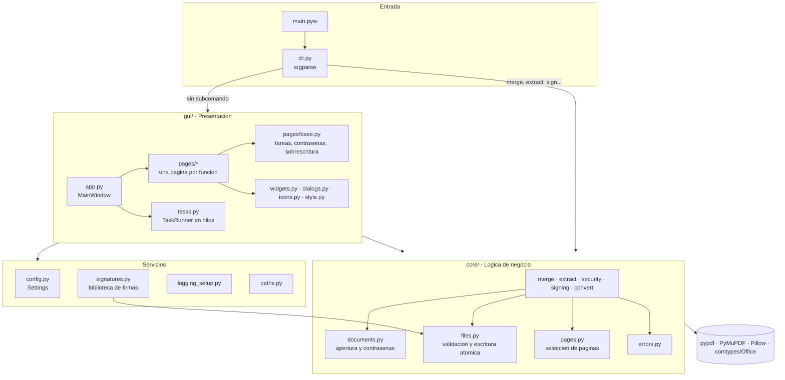
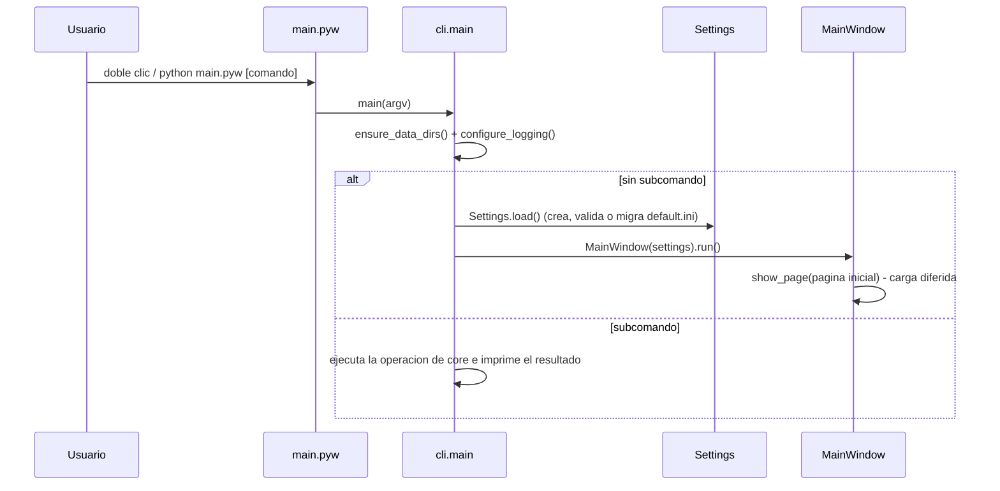
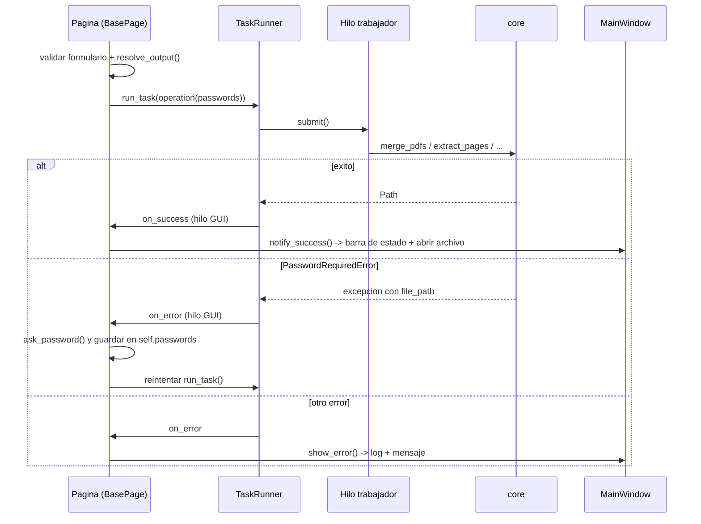
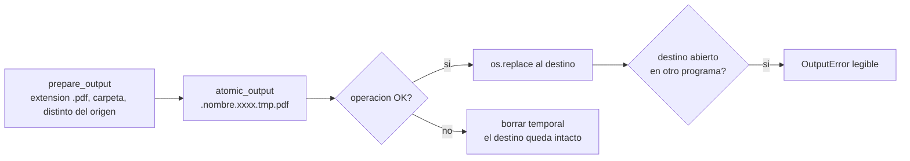
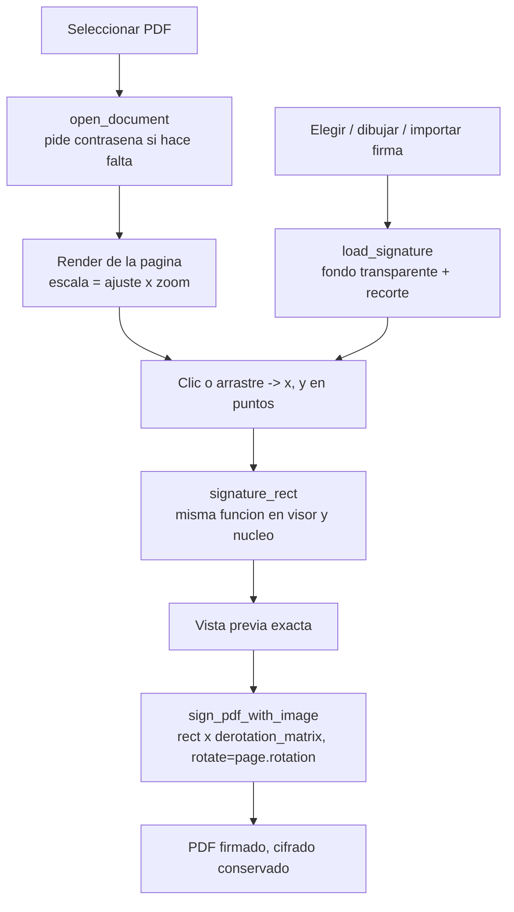
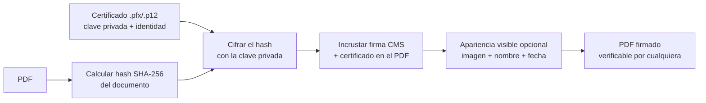

<div align="center">
    <h1>PDF Management</h1>
    <p>Herramienta de escritorio <b>gratuita y 100% local</b> para unir, extraer, convertir, firmar y proteger PDFs.</p>
    
    
    
    
</div>

## Tabla de contenido

1. [Proposito](#proposito)
2. [Funcionalidades](#funcionalidades)
3. [Inicio rapido](#inicio-rapido)
4. [Linea de comandos](#linea-de-comandos)
5. [Arquitectura](#arquitectura)
6. [Estructura del proyecto](#estructura-del-proyecto)
7. [Referencia de modulos](#referencia-de-modulos)
8. [Flujos principales](#flujos-principales)
9. [Datos, configuracion y registros](#datos-configuracion-y-registros)
10. [Decisiones de diseno](#decisiones-de-diseno)
11. [Pruebas](#pruebas)
12. [Como agregar una funcionalidad](#como-agregar-una-funcionalidad)
13. [Propuesta: firma digital con certificado](#propuesta-firma-digital-con-certificado)
14. [Hoja de ruta](#hoja-de-ruta)
15. [Creditos](#creditos)

---

## Proposito

Las herramientas para manejar PDFs suelen ser de pago o exigen subir los documentos a internet. PDF Management resuelve las tareas mas comunes de forma **facil y gratuita**, garantizando la privacidad: todo se ejecuta en el equipo del usuario y la aplicacion **no tiene ninguna conexion a internet**.

## Funcionalidades

| Seccion | Que hace | Detalles |
|---|---|---|
| **Unir** | Combina varios PDFs en uno | Arrastrar archivos o carpetas, reordenar, ordenar A-Z, marcador por archivo, PDFs protegidos |
| **Extraer** | Crea un PDF con paginas seleccionadas | Rangos (`1-3, 8, 10-`), `todo`/`impar`/`par`, vista previa de la seleccion, proteger el resultado |
| **Convertir** | Word y Excel a PDF | `.docx .doc .rtf .xlsx .xls` con Microsoft Office |
| **Firmar** | Estampa una imagen de firma | Visor con zoom, clic y arrastre, paginas rotadas, todas las paginas, dibujar o importar firmas |
| **Proteger** | Cifra o descifra un PDF | AES-256, deteccion automatica del estado, confirmacion de contrasena |
| **Ajustes** | Preferencias | Modo claro/oscuro/sistema, color de acento, escala, pagina inicial, carpeta de salida |

Ademas: escritura atomica (un error nunca deja archivos corruptos), nunca sobrescribe sin preguntar, barra de estado con acciones **Abrir** y **Mostrar en carpeta**, atajos `Ctrl+1..6` y `F1`, y una CLI con las mismas operaciones.

## Inicio rapido

Requisitos: Windows 10/11 y Python 3.14 (funciona desde 3.12). Microsoft Office solo es necesario para **Convertir**.

```bash
python -m venv venv
```

```bash
venv\Scripts\python.exe -m pip install -r requirements.txt
```

```bash
venv\Scripts\pythonw.exe main.pyw
```

Tambien basta con hacer doble clic en `main.pyw`. Al primer arranque se crean automaticamente las carpetas `config/`, `log/`, `signs/` y `export/` con valores por defecto; no hace falta ningun paso de despliegue.

## Linea de comandos

Sin argumentos se abre la interfaz grafica. Con un subcomando se ejecuta la operacion directamente (use `python.exe`, no `pythonw.exe`, para ver la salida):

```bash
venv\Scripts\python.exe main.pyw --help
```

| Comando | Ejemplo |
|---|---|
| `merge` | `python main.pyw merge a.pdf b.pdf -o unido.pdf --bookmarks` |
| `extract` | `python main.pyw extract informe.pdf -p "1-3,8" -o resumen.pdf` |
| `convert` | `python main.pyw convert carta.docx -o carta.pdf` |
| `sign` | `python main.pyw sign contrato.pdf --image firma.png --page 2 --x 400 --y 700 --width 150` |
| `lock` | `python main.pyw lock contrato.pdf -o protegido.pdf` |
| `unlock` | `python main.pyw unlock protegido.pdf -o libre.pdf` |

Si no se pasa `--password`, la contrasena se solicita de forma oculta. Codigos de salida: `0` exito, `1` error de la operacion, `2` argumentos invalidos.

---

## Arquitectura

La aplicacion esta organizada en **capas con dependencias en una sola direccion**: la interfaz conoce al nucleo, pero el nucleo no sabe nada de la interfaz. Esto permite probar toda la logica sin abrir ventanas y reutilizarla desde la CLI.



| Capa | Responsabilidad | Regla |
|---|---|---|
| **Entrada** (`main.pyw`, `cli.py`) | Parsear argumentos, preparar carpetas y logging, elegir GUI o comando | No contiene logica de PDFs |
| **Presentacion** (`gui/`) | Ventanas, validacion de formularios, dialogos, hilos | Solo llama funciones publicas de `core` |
| **Servicios** (`config`, `signatures`, `paths`, `logging_setup`) | Estado persistente y recursos de la aplicacion | Sin dependencias de la GUI |
| **Nucleo** (`core/`) | Operaciones sobre PDFs | Funciones puras de entrada/salida de archivos; errores tipados |

## Estructura del proyecto

```
PDFManagement/
├── main.pyw                    # Punto de entrada (doble clic = GUI)
├── requirements.txt            # Dependencias de ejecucion (versiones fijas)
├── requirements-dev.txt        # + pytest
├── pyproject.toml              # Metadatos y configuracion de pytest
├── assets/
│   ├── icons/app.ico           # Icono de la aplicacion
│   ├── images/qr.png           # QR de donacion
│   └── themes/*.json           # Temas de color de CustomTkinter
├── docs/user_guide.md          # Guia de uso (se muestra con F1)
├── src/pdfmanagement/
│   ├── __init__.py             # Nombre y version
│   ├── __main__.py             # python -m pdfmanagement
│   ├── cli.py                  # Subcomandos y arranque
│   ├── paths.py                # Rutas de recursos y datos
│   ├── config.py               # Preferencias (settings.ini)
│   ├── logging_setup.py        # Registro rotativo
│   ├── signatures.py           # Biblioteca de firmas (signs/)
│   ├── core/
│   │   ├── errors.py           # Jerarquia de excepciones
│   │   ├── files.py            # Validacion de rutas y escritura atomica
│   │   ├── documents.py        # Apertura con contrasena, PdfInfo
│   │   ├── pages.py            # Interprete de selecciones de paginas
│   │   ├── merge.py            # Unir
│   │   ├── extract.py          # Extraer
│   │   ├── security.py         # Proteger / desproteger
│   │   ├── signing.py          # Firma visual
│   │   └── convert.py          # Office -> PDF
│   └── gui/
│       ├── app.py              # MainWindow: barra lateral, paginas, estado
│       ├── tasks.py            # TaskRunner (hilos + sondeo seguro)
│       ├── style.py            # Tipografia, espaciado y colores
│       ├── icons.py            # Iconos desde la fuente de Windows
│       ├── widgets.py          # Card, FileField, PasswordField, ToolTip...
│       ├── dialogs.py          # Contrasena, ayuda, lienzo de firma
│       ├── system.py           # Abrir archivos / mostrar en carpeta
│       └── pages/
│           ├── registry.py     # Lista ordenada de paginas
│           ├── base.py         # BasePage
│           └── merge.py · extract.py · convert.py · sign.py · security.py · settings.py
└── tests/                      # Pruebas automatizadas (pytest)
```

Carpetas creadas en tiempo de ejecucion (ignoradas por git): `config/`, `log/`, `signs/`, `export/`.

## Referencia de modulos

### `core` - operaciones

Todas las funciones validan sus entradas, escriben el resultado de forma atomica y **devuelven la ruta generada**. Las paginas para el usuario siempre empiezan en **1**.

| Funcion | Descripcion |
|---|---|
| `merge_pdfs(pdf_files, output_file, *, passwords=None, add_bookmarks=False)` | Une en el orden recibido; ignora duplicados; `passwords` es un `dict[Path, str]` para PDFs protegidos |
| `extract_pages(input_file, output_file, selection, *, password=None, output_password=None)` | Copia las paginas de `selection`; puede cifrar el resultado |
| `lock_pdf(input_file, output_file, password, *, owner_password=None)` | Cifra con AES-256 conservando marcadores, formularios y metadatos |
| `unlock_pdf(input_file, output_file, password)` | Copia sin cifrado; exige la contrasena correcta |
| `sign_pdf_with_image(input_file, output_file, signature_image, placement, *, password=None)` | Estampa la firma segun un `SignaturePlacement`; conserva el cifrado del original |
| `convert_to_pdf(input_file, output_file)` | Word/Excel a PDF via COM |
| `parse_page_selection(selection, total_pages)` | Texto a indices base cero (`"3,1-2"` -> `[2, 0, 1]`) |
| `get_pdf_info(pdf_file)` | `PdfInfo(path, page_count, size_bytes, encrypted)` sin pedir contrasena |
| `open_document(path, password)` | Abre con PyMuPDF manejando contrasenas (usado por el visor) |
| `load_signature(image)` | Imagen RGBA lista para estampar: fondo blanco transparente y margenes recortados |
| `signature_rect(page_rect, placement, aspect_ratio)` | Rectangulo visible de la firma, ajustado a la pagina; **compartido por visor y estampa** |
| `unique_path(path)` | `nombre (2).pdf` si `path` ya existe |

`SignaturePlacement(x, y, width=150, page_number=None, all_pages=False)`: coordenadas en puntos sobre la pagina **tal como se ve** (origen arriba a la izquierda); `page_number=None` significa la ultima pagina.

### `core.errors` - excepciones

```
PdfManagementError            # base: su mensaje se muestra al usuario
├── InvalidInputError         # rutas, extensiones, selecciones, validaciones
├── OutputError               # no se pudo escribir (p. ej. archivo abierto en otro programa)
├── ConversionError           # Office no disponible o fallo la exportacion
└── PasswordRequiredError     # .file_path indica que PDF necesita contrasena
    └── WrongPasswordError    # la contrasena indicada no es valida
```

Cualquier otra excepcion se considera un **error inesperado**: se registra con traza completa en `log/error.log` y se informa al usuario.

### Servicios

| Modulo | Elementos clave |
|---|---|
| `config.py` | `Settings` (dataclass): `load()` crea, valida y migra; `save()` escribe `config/settings.ini`; `output_path` |
| `signatures.py` | `list_signatures()`, `import_signature()`, `signature_path_for()`, `delete_signature()` |
| `paths.py` | Rutas de recursos (`ASSETS_DIR`, `THEMES_DIR`...) y datos (`CONFIG_DIR`, `LOG_DIR`, `SIGNATURES_DIR`, `EXPORT_DIR`); soporte para PyInstaller |
| `logging_setup.py` | `configure_logging(debug=False)`: `log/app.log` y `log/error.log` rotativos, captura de excepciones no controladas |
| `cli.py` | `main(argv) -> int`, `build_parser()` |

### `gui` - presentacion

| Elemento | Responsabilidad |
|---|---|
| `MainWindow` (`app.py`) | Crea la ventana (CustomTkinter + tkdnd), barra lateral, carga diferida de paginas, barra de estado, `notify_success()`, `show_error()`, apariencia, reinicio, recordar tamano |
| `BasePage` (`pages/base.py`) | Encabezado, `run_task()` (hilo + reintento con contrasena), `resolve_output()` (politica de sobrescritura), `default_output()`, `guard()` |
| `TaskRunner` (`tasks.py`) | Pool de 2 hilos; el hilo de la GUI sondea cada 80 ms y ejecuta los callbacks |
| `FileField`, `PasswordField`, `Card`, `ToolTip`, `enable_file_drop` (`widgets.py`) | Componentes reutilizables y consistentes |
| `ask_password`, `HelpWindow`, `SignaturePad` (`dialogs.py`) | Ventanas modales y secundarias |
| `icon(name, size, color)` (`icons.py`) | Iconos vectoriales de Segoe Fluent Icons en dos colores (claro/oscuro) |

## Flujos principales

### Arranque



### Ejecucion de una operacion desde la GUI (con contrasena)



### Escritura atomica de resultados



### Firma visual



### Politica de sobrescritura (`BasePage.resolve_output`)

| Origen de la ruta de salida | Si el archivo ya existe |
|---|---|
| Sugerida automaticamente | Se elige un nombre libre: `nombre (2).pdf` |
| Elegida en "Guardar como" | Se respeta (el dialogo del sistema ya pregunto) |
| Escrita a mano | Se pide confirmacion |

## Datos, configuracion y registros

| Ruta | Contenido |
|---|---|
| `config/settings.ini` | Preferencias. Secciones `[Window]`, `[Appearance]`, `[General]`. Se regenera si falta; los valores invalidos se corrigen al cargar |
| `config/default.ini` | Formato anterior (v3). Se migra automaticamente a `settings.ini` |
| `log/app.log` | Actividad (INFO; DEBUG con `--debug`). Rotacion 1 MB x 3 |
| `log/error.log` | Errores con traza completa |
| `signs/` | Firmas guardadas (PNG/JPG) |
| `export/` | Carpeta de salida por defecto (configurable en Ajustes) |

Ejemplo de `settings.ini`:

```ini
[Window]
window_width = 1180
window_height = 760
window_maximized = no

[Appearance]
appearance_mode = System
color_theme = AzulOscuro
ui_scaling = 1.0

[General]
initial_page = Unir
open_after_save = yes
output_dir =
```

Para mover todos los datos del usuario (por ejemplo a `%APPDATA%` al distribuir la app) basta con cambiar `DATA_DIR` en `paths.py`.

## Decisiones de diseno

- **Nucleo sin GUI.** Facilita las pruebas, la CLI y futuras interfaces.
- **pypdf + PyMuPDF.** pypdf para operaciones estructurales y cifrado AES-256 (conserva marcadores y formularios); PyMuPDF para renderizar y estampar imagenes con precision.
- **Coordenadas "como se ve".** El usuario trabaja sobre la pagina visible; el nucleo convierte con `derotation_matrix`, asi las paginas rotadas funcionan sin casos especiales.
- **Errores tipados.** La GUI decide que hacer segun el tipo (`PasswordRequiredError` -> pedir clave) en lugar de comparar textos.
- **Hilos sin tocar widgets.** Tkinter no es seguro entre hilos; los trabajadores solo calculan y el hilo principal sondea los resultados.
- **Preferencias autocorregibles.** Un `settings.ini` danado o de una version anterior nunca impide arrancar.
- **Iconos desde la fuente del sistema.** Sin PNGs que mantener, nitidos a cualquier escala y adaptados al tema.
- **Carga diferida de paginas.** Arranque rapido: cada pagina se construye la primera vez que se abre.

## Pruebas

```bash
venv\Scripts\python.exe -m pip install -r requirements-dev.txt
```

```bash
venv\Scripts\python.exe -m pytest
```

| Archivo | Cubre |
|---|---|
| `tests/test_pages.py` | Selecciones validas e invalidas |
| `tests/test_operations.py` | Unir, extraer, proteger, firmar (incluye paginas rotadas 0/90/180/270, limites de pagina, cifrado conservado), escritura atomica |
| `tests/test_config_cli.py` | Valores por defecto, validacion, migracion de `default.ini`, CLI |
| `tests/test_convert.py` | Conversion real con Word y Excel (se omite si Office no esta instalado) |

Los PDFs e imagenes de prueba se generan al vuelo; las pruebas no dependen de archivos externos.

## Como agregar una funcionalidad

Ejemplo: "Comprimir PDF".

1. **Nucleo**: crear `core/compress.py` con `compress_pdf(input_file, output_file, ...) -> Path`, usando `require_file`, `prepare_output` y `atomic_output`, y lanzando subclases de `PdfManagementError`. Exportarla en `core/__init__.py`.
2. **Pruebas**: agregar casos en `tests/` con PDFs generados por `pdf_factory`.
3. **CLI** (opcional): un subcomando en `cli.build_parser()` y su entrada en `_COMMANDS`.
4. **GUI**: crear `gui/pages/compress.py` con una subclase de `BasePage` (`name`, `title`, `subtitle`, `icon_name`, `build()`), usar `FileField` y `self.run_task(...)`.
5. **Registro**: anadir la clase a `PAGES` en `gui/pages/registry.py` (aparece en la barra lateral con su atajo).
6. **Documentacion**: actualizar `docs/user_guide.md` y este README.

---

## Propuesta: firma digital con certificado

La firma actual es **visual**: demuestra intencion, pero cualquiera podria copiar la imagen y no detecta cambios posteriores en el documento. Una **firma digital** (PAdES, estandar europeo e internacional) agrega una prueba criptografica de **autoria** e **integridad**: si alguien modifica el PDF despues de firmarlo, los lectores (Adobe Acrobat, etc.) muestran la firma como invalida.

### Como funciona



### Propuesta de implementacion

| Aspecto | Propuesta |
|---|---|
| **Libreria** | [`pyHanko`](https://github.com/MatthiasValvekens/pyHanko) (Python puro, MIT, mantenida, soporta PAdES B-B/B-T/B-LT y firmas visibles) |
| **Certificado** | Archivo `.pfx` / `.p12` emitido por una entidad de certificacion reconocida (por ejemplo, en Colombia: Certicamara, GSE, Andes SCD). Para pruebas internas se puede generar uno autofirmado |
| **Contrasena del certificado** | Se pide en cada firma y nunca se guarda en disco |
| **Apariencia** | Reutiliza el visor actual: el usuario ubica el recuadro y se combina la imagen de su firma con "Firmado digitalmente por *Nombre*, *fecha*" |
| **Nivel** | PAdES **B-B** por defecto (100% sin internet). Opcional **B-T** con sello de tiempo de una TSA; requiere conexion, por eso seria una opcion explicita y desactivada por defecto |
| **Arquitectura** | Nuevo `core/digital_signing.py` con `sign_pdf_with_certificate(input, output, pfx_path, pfx_password, placement=None, reason=None, location=None)`; `SignPage` agrega un selector "Firma visual / Firma digital" |
| **Orden de operaciones** | La firma digital debe ser el **ultimo** cambio: unir, extraer o proteger despues de firmar invalida la firma. La GUI lo advertira |
| **Varias firmas** | pyHanko usa actualizaciones incrementales, asi varias personas pueden firmar el mismo PDF sin invalidar las firmas previas |
| **Verificacion** (fase 2) | Pagina para validar firmas existentes: firmante, fecha, integridad y confianza del certificado |
| **Fuera de alcance inicial** | Tokens USB / tarjetas (PKCS#11) y el almacen de certificados de Windows; se pueden agregar despues sobre la misma funcion |

**Confianza**: con un certificado autofirmado la firma es valida criptograficamente, pero Adobe mostrara "identidad desconocida". Para que aparezca como confiable automaticamente, el certificado debe provenir de una entidad incluida en la lista AATL de Adobe o en la lista de confianza del pais.

Esfuerzo estimado: 1 modulo de nucleo + pruebas con un certificado autofirmado generado en las pruebas + ajuste de `SignPage`. Nueva dependencia: `pyHanko` (y `pyhanko-certvalidator`).

## Hoja de ruta

- [ ] Firma digital con certificado (ver propuesta).
- [ ] Conversion sin Microsoft Office (alternativa: LibreOffice en modo headless).
- [ ] Comprimir PDF (optimizar imagenes y limpiar objetos).
- [ ] Dividir un PDF en varios archivos (por rangos o cada N paginas).
- [ ] Rotar y reordenar paginas con miniaturas.
- [ ] Convertir imagenes (JPG/PNG) a PDF.
- [ ] Empaquetado distribuible (PyInstaller + instalador) y datos en `%APPDATA%`.

---

<div align="center">
    <h2>Creditos</h2>
    <h3>Desarrollo</h3>
    <h5>Sebastian Ávila</h5>
    <h3>QA</h3>
    <!-- <h5>  </h5> -->
</div>
